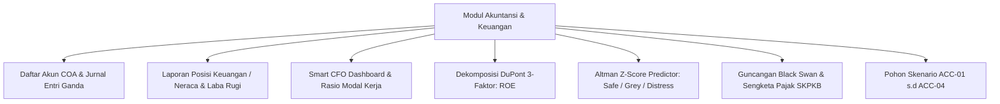

# PANDUAN PRAKTIKUM & TUTORIAL DOSEN KEUANGAN & AKUNTANSI
## LABORATORIUM VLAB-ERP ENTERPRISE EDITION
## PROGRAM STUDI MANAJEMEN — UNIVERSITAS WIRA BHAKTI

---

### I. PERAN & FOKUS DOSEN KEUANGAN & AKUNTANSI
Sebagai Dosen Pengampu Bidang **Manajemen Keuangan & Akuntansi Bisnis Digital**, Anda bertanggung jawab memandu mahasiswa dalam:
1. Memahami pencatatan akuntansi entri ganda otomatis (*Automatic Double-Entry Ledger*) dan integrasi buku besar ke seluruh transaksi operasional (PO, WO, Payroll, SO).
2. Mengevaluasi posisi likuiditas, solvabilitas, dan kecukupan modal kerja (*Net Working Capital*).
3. Menganalisis kinerja profitabilitas menggunakan **Model Dekomposisi DuPont 3-Faktor**.
4. Mengukur risiko kebangkrutan perusahaan manufaktur melalui **Altman Z-Score Distress Predictor**.
5. Menghadapi guncangan tak terduga (*Black Swan Financial Shocks*), mitigasi sengketa Surat Ketetapan Pajak Kurang Bayar (SKPKB), dan restrukturisasi pinjaman perbankan (*Covenant Breach*).

---

### II. FITUR UTAMA MODUL KEUANGAN & AKUNTANSI DI VLAB-ERP

#### 2. Rantai Pembukuan Berpasangan Otomatis (*Double-Entry Accounting Automator*)
Sistem VLab-ERP secara otomatis menjurnal setiap transaksi operasional ke buku besar:
- **Transaksi PO (Beli Bahan Baku Tempo)**:
  - *Debit*: Persediaan Bahan Baku (Akun 1030)
  - *Kredit*: Utang Usaha / AP (Akun 2010)
  - *Dampak Anggaran*: Menambah realisasi belanja pada `DepartmentBudget` Pengadaan (*Procurement*).
- **Pelunasan Hutang Vendor (AP Quick Pay)**:
  - *Debit*: Utang Usaha / AP (Akun 2010)
  - *Kredit*: Kas & Bank (Akun 1010)
- **Transaksi SO (Penjualan Selesai/Won)**:
  - *Debit*: Piutang Usaha / AR (Akun 1020)
  - *Kredit*: Pendapatan Penjualan (Akun 4010)
- **Work Order & Maintenance**:
  - *Debit*: Biaya Operasional Produksi (Akun 5010)
  - *Kredit*: Kas / Utang Akrual
  - *Dampak Anggaran*: Menambah realisasi belanja pada `DepartmentBudget` Produksi.

---

### III. MODEL DIAGNOSTIK SMART CFO (DUPONT & ALTMAN Z-SCORE)

#### 1. Rasio Likuiditas & Modal Kerja
- **Current Ratio** $= \frac{\text{Aset Lancar}}{\text{Liabilitas Lancar}}$ (Standar Sehat: $> 1.5\text{x}$, Batas Kritis: $1.2\text{x}$).
- **Quick Ratio (Acid-Test)** $= \frac{\text{Kas} + \text{Piutang}}{\text{Liabilitas Lancar}}$ (Standar Sehat: $> 1.0\text{x}$).
- **Cash Ratio** $= \frac{\text{Kas}}{\text{Liabilitas Lancar}}$ (Standar Aman: $> 0.5\text{x}$).

#### 2. Dekomposisi DuPont 3-Faktor
Smart CFO memecah Return on Equity (ROE) menjadi tiga pendorong kinerja independen:
$$\text{ROE} = \underbrace{\left( \frac{\text{Net Income}}{\text{Revenue}} \right)}_{\text{Net Profit Margin}} \times \underbrace{\left( \frac{\text{Revenue}}{\text{Total Assets}} \right)}_{\text{Asset Turnover}} \times \underbrace{\left( \frac{\text{Total Assets}}{\text{Total Equity}} \right)}_{\text{Equity Multiplier}}$$
- **Net Profit Margin**: Mengukur efisiensi penetapan harga dan pengendalian beban operasional.
- **Asset Turnover**: Mengukur efisiensi pemanfaatan aset pabrik dalam menghasilkan omzet.
- **Equity Multiplier (Financial Leverage)**: Mengukur proporsi pendanaan aset yang dibiayai utang.

#### 3. Model Prediksi Kebangkrutan Altman Z-Score
Dihitung secara deterministik menggunakan model *Altman Z'-Score for Private Manufacturing*:
$$Z = 0.717(X_1) + 0.847(X_2) + 3.107(X_3) + 0.420(X_4) + 0.998(X_5)$$
- $X_1 = \frac{\text{Working Capital}}{\text{Total Assets}}$
- $X_2 = \frac{\text{Retained Earnings}}{\text{Total Assets}}$
- $X_3 = \frac{\text{EBIT}}{\text{Total Assets}}$
- $X_4 = \frac{\text{Book Value Equity}}{\text{Total Liabilities}}$
- $X_5 = \frac{\text{Sales}}{\text{Total Assets}}$

**Klasifikasi Zona Kesehatan Finansial**:
- 🟢 **SAFE ZONE** ($Z \ge 2.90$): Perusahaan sangat sehat, risiko gagal bayar mendekati 0%.
- 🟡 **GREY ZONE** ($1.23 \le Z < 2.90$): Perusahaan waspada, butuh perbaikan perputaran modal kerja.
- 🔴 **DISTRESS ZONE** ($Z < 1.23$): Bahaya kebangkrutan nyata, terancam likuidasi dalam 2 periode.

---

### IV. POHON KEPUTUSAN SKENARIO KEUANGAN (DOMAIN AKUNTANSI)

Dosen Keuangan mengampu **4 Skenario Strategis** pada tab **Pohon Keputusan Multi-Skenario**:

| Kode | Judul Skenario | Konteks Masalah | Pilihan Cabang & Dampak Domino |
| :--- | :--- | :--- | :--- |
| **ACC-01** | **Pemeriksaan Pajak Mendadak (SKPKB PPN)** | KPP menerbitkan SKPKB senilai Rp 25 Juta atas selisih faktur pajak masukan 2 tahun lalu dengan tempo bayar 14 hari. | • **Cabang A**: Bayar Lunas SKPKB Rp 25 Juta (Kas terpotong Rp 25 Juta, Buku pajak dinyatakan Clean & Clear, terbit *SSP No. 082*). • **Cabang B**: Sewa Konsultan Pajak Rp 8 Juta & Ajukan Keberatan (Hemat kas saat ini, proses sengketa 6-12 bulan). |
| **ACC-02** | **Pilihan Kebijakan Penyusutan Aset Tetap** | Pembelian mesin baru Rp 100 Juta memerlukan penetapan metode depresiasi akuntansi. | • **Cabang A**: Saldo Menurun Ganda (*Double Declining*) (Beban awal besar, hemat pajak riil via *Tax Shield*). • **Cabang B**: Garis Lurus (*Straight Line*) (Laba bersih stabil merata setiap periode). |
| **ACC-03** | **Peringatan Likuiditas Bank & Covenant Breach** | Bank mitra memperingatkan Current Ratio mendekati batas 1.2x. Terancam penalti bunga 3% dan pelunasan dipercepat. | • **Cabang A**: Restrukturisasi Utang Bank & Tambah Modal Ekuitas (Current ratio aman $> 1.8\text{x}$, terbit *Addendum Kredit Bank No. 093*). • **Cabang B**: Likuidasi Cepat Stok Lambat Diskon 40% (Inflow kas segar masuk, catat kerugian diskon di Laba Rugi). |
| **ACC-04** | **Keputusan Belanja Modal Ekspansi (Capex)** | Rencana pembelian lini otomatisasi perakitan senilai Rp 80 Juta dengan Payback Period 14 bulan. | • **Cabang A**: Danai 50% Kas Internal + 50% Leasing (Kapasitas naik 60%, terbit *Kontrak Leasing No. 018*). • **Cabang B**: Tunda investasi & Maksimalkan mesin saat ini (Kas aman, kapasitas tetap di batas maksimum). |

---

### V. PANDUAN PRAKTIKUM MINGGU KE-12 S.D MINGGU KE-14

#### Pertemuan 12: Audit Laporan Posisi Keuangan & Jurnal Buku Besar
1. **Aktivitas Dosen**: Bimbing mahasiswa membuka **Modul Akuntansi $\rightarrow$ Buku Besar & Neraca Saldo**.
2. **Tugas Mahasiswa**: Rekonsiliasi seluruh arus kas masuk dari penjualan dan arus kas keluar dari PO pengadaan bahan baku serta payroll pegawai.
3. **Analisis**: Hitung modal kerja bersih (*Net Working Capital*) kelompok: $\text{NWC} = \text{Aset Lancar} - \text{Liabilitas Lancar}$.

#### Pertemuan 13: Dekomposisi DuPont 3-Faktor di Smart CFO Dashboard
1. **Instruksi ke Mahasiswa**: Buka tab **Misi Hub $\rightarrow$ Sub-Tab Smart CFO: DuPont & Altman Z-Score**.
2. **Tugas Mahasiswa**: Analisis kartu interaktif 3 pendorong ROE kelompok.
3. **Studi Komparasi**: Bandingkan kelompok yang memiliki ROE tinggi karena *Asset Turnover* yang agresif vs kelompok yang memiliki ROE tinggi karena *Financial Leverage* (utang tinggi).

#### Pertemuan 14: Simulasi Prediksi Kebangkrutan & Audit Pajak SKPKB
1. **Aktivitas Dosen**: Klik tombol **"Guncangan Black Swan"** di portal untuk memicu audit pajak mendadak atau gagal bayar piutang klien.
2. **Tugas Mahasiswa**: Buka Skenario ACC-01 dan ACC-03. Mahasiswa harus mempertahankan skor Altman Z di atas $2.90$ (Safe Zone) setelah membayar kewajiban pajak dan melunasi denda perbankan.
3. **Output Praktikum**: Mahasiswa menerbitkan dan mengunduh dokumen **Surat Setoran Pajak (SSP) Pelunasan SKPKB No. 082/SSP-KPP/2026**.

---

### VI. RUBRIK PENILAIAN PRAKTIKUM DOSEN KEUANGAN & AKUNTANSI

| Kriteria Penilaian | Indikator Ketercapaian | Bobot |
| :--- | :--- | :---: |
| **Kesehatan Rasio Likuiditas & Modal Kerja** | Current Ratio $\ge 1.5\text{x}$, Cash Ratio $\ge 0.5\text{x}$, Net Working Capital positif. | 30% |
| **Optimasi Model DuPont (ROE)** | Nilai ROE $\ge 15\%$ didorong oleh Net Profit Margin yang sehat dan perputaran aset optimal. | 25% |
| **Ketahanan Solvabilitas & Altman Z-Score** | Mempertahankan skor Z pada **Safe Zone ($Z \ge 2.90$)** sepanjang periode simulasi. | 25% |
| **Penyelesaian Kasus Pajak & Bank** | Eksekusi tepat pada skenario ACC-01 s.d ACC-04 dan kepatuhan penyetoran pajak negara. | 20% |
| **TOTAL** | | **100%** |
