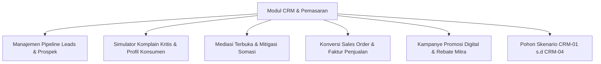

# PANDUAN PRAKTIKUM & TUTORIAL DOSEN PEMASARAN & CRM
## LABORATORIUM VLAB-ERP ENTERPRISE EDITION
## PROGRAM STUDI MANAJEMEN — UNIVERSITAS WIRA BHAKTI

---

### I. PERAN & FOKUS DOSEN PEMASARAN
Sebagai Dosen Pengampu Bidang **Manajemen Pemasaran & CRM**, Anda bertanggung jawab membimbing mahasiswa dalam memahami:
1. Pengelolaan prospek penjualan (*Leads*) dan konversi menjadi pesanan penjualan resmi (*Sales Order*).
2. Penanganan komplain pelanggan kritis (*Crisis CRM*) berbasis profil emosional konsumen (*Customer Temperaments*).
3. Negosiasi komersial B2B, penawaran tender pemerintah (*E-Katalog B2G*), kebijakan batas kredit (*Term of Payment*), dan program loyalitas agen (*Year-End Rebate*).
4. Penyelamatan kontrak jangka panjang dan perlindungan reputasi pasar korporasi.

---

### II. FITUR UTAMA MODUL PEMASARAN & CRM DI VLAB-ERP

#### 1. Manajemen Pipeline Prospek & Keluhan Pelanggan
- Akses melalui Menu Navigasi: **Portal ERP Mahasiswa $\rightarrow$ Modul CRM & Pelanggan** atau **Konsol Dosen $\rightarrow$ Kasus & Skenario**.
- Mahasiswa dapat memantau status prospek: `Baru (New)`, `Proposisi Nilai (Proposition)`, `Negosiasi (Negotiation)`, `Selesai (Won/Resolved)`, atau `Batal (Lost)`.

#### 2. Generator Karakter Emosional Pelanggan (*Customer Temperament Engine*)
Pelanggan di VLab-ERP memiliki 4 kepribadian realistis non-deterministik:
- **Akun Korporat Eskalasi Kritis (Merah)**: Bertoleransi rendah (15%), menuntut kompensasi minimal 15% atau melayangkan somasi hukum dan viral media sosial.
- **Mitra Bisnis Jangka Panjang (Hijau)**: Sangat kooperatif (toleransi 75%), mengutamakan penggantian unit berkualitas tinggi dengan tuntutan diskon minim (5%).
- **Klien Institusi Strategis (Ungu)**: Pasif-agresif (toleransi 40%), menuntut diskon kompensasi 10% dan respons cepat sebelum melapor ke asosiasi industri.
- **Distributor Utama Regional (Biru)**: Kalkulatif dan cerdas bernegosiasi (toleransi 50%), meminta kompensasi unit ekstra dan perpanjangan tempo pembayaran.

> **💡 Tips Dosen**: Gunakan tombol **"Acak Respon Pelanggan"** pada kartu keluhan untuk mengubah secara dinamis profil emosi dan narasi komplain pelanggan, menguji ketangguhan mahasiswa dalam menghadapi tipe konsumen yang berbeda-beda!

#### 4. Rantai Otomasi Transaksi (Sales Order ➔ MRP ➔ SCM ➔ Akuntansi)
Ketika deal penjualan di CRM berstatus **Won / Selesai**, sistem VLab-ERP secara cerdas mengeksekusi integrasi otomatis (*The Ripple Engine*):
1. **Pengecekan Stok Barang Jadi**: Sistem memeriksa apakah stok barang jadi di gudang mencukupi.
2. **Otomasi Work Order (WO)**: Jika stok kurang, sistem otomatis menerbitkan *Perintah Kerja Produksi (WO)* sesuai kebutuhan BOM.
3. **Otomasi Purchase Order (PO)**: Jika bahan baku mentah (IC Microcontroller, PCB, Display) tidak cukup di gudang, sistem langsung menerbitkan *Pesanan Pembelian (PO)* ke vendor rekanan.
4. **Otomasi Jurnal Akuntansi**: Menambah Piutang Usaha (AR Akun 1020), Pendapatan Penjualan (Akun 4010), dan memotong plafon anggaran operasional terkait.
5. **Pencatatan Audit Trail**: Seluruh pergerakan transaksi tercatat pada *Executive Live Log Feed* di dashboard utama.

---

### III. POHON KEPUTUSAN SKENARIO PEMASARAN (DOMAIN CRM)

Dosen Pemasaran mengampu **4 Skenario Strategis** pada tab **Pohon Keputusan Multi-Skenario**:

| Kode | Judul Skenario | Konteks Masalah | Pilihan Cabang & Dampak Domino |
| :--- | :--- | :--- | :--- |
| **CRM-01** | **Ancaman Somasi Hukum Klien Utama (PT Megatama)** | 35 unit mesin terlambat 10 hari dan salah kalibrasi. Klien menuntut ganti rugi Rp 50 Juta atau perkara dibawa ke Pengadilan Niaga. | • **Cabang A**: Diskon 15% + Teknisi Onsite (Biaya Rp 22 Juta, Somasi dicabut, terbit *Akta Perdamaian Bipartit*). • **Cabang B**: Lawan somasi via kuasa hukum (*Force Majeure*) (Biaya Rp 15 Juta, Hubungan putus, Piutang Rp 35 Juta macet). • **Cabang C**: Ganti unit baru utuh 100% (Biaya HPP Rp 18 Juta, Nilai invoice utuh tertagih). |
| **CRM-02** | **Peluang Tender Pemerintah (E-Katalog B2G)** | Tender lab Kemendikbudristek Rp 300 Juta mensyaratkan Bank Guarantee dan sertifikasi TKDN minimal 40%. | • **Cabang A**: Ikut tender penuh mandiri (Biaya jaminan bank Rp 25 Juta, Margin profit 100% milik sendiri). • **Cabang B**: Kemitraan Konsorsium KSO dengan distributor lokal (Biaya Rp 5 Juta, Berbagi margin 30% dengan mitra). |
| **CRM-03** | **Distributor Minta Perpanjangan TOP 90 Hari** | Distributor penyerap 45% penjualan meminta perpanjangan tempo pembayaran dari 30 hari ke 90 hari. | • **Cabang A**: Tolak dan pertahankan TOP 30 hari (Arus kas aman, DSO rendah, distributor pangkas kuota 30%). • **Cabang B**: Setujui TOP 90 hari dengan jaminan Bilyet Giro Mundur & bunga 2% (Penjualan maksimal, terbit *Addendum Kredit*). |
| **CRM-04** | **Program Insentif Rebate Tahunan Mitra** | Asosiasi reseller menuntut skema cashback akhir tahun untuk mendongkrak penjualan produk VLab. | • **Cabang A**: Skema Rebate Berjenjang 5% (Biaya insentif Rp 15 Juta, Volume penjualan melonjak 28%). • **Cabang B**: Tolak rebate kas, fokus iklan medsos (Biaya iklan Rp 5 Juta, Brand awareness naik, reseller datar). |

---

### IV. PANDUAN PRAKTIKUM MINGGU KE-4 S.D MINGGU KE-7

#### Pertemuan 4: Analisis Perilaku Konsumen & Manajemen Komplain
1. **Instruksi ke Mahasiswa**: Buka Modul CRM, temukan data pelanggan dengan tiket keluhan aktif (*is_complaint = true*).
2. **Aktivitas Dosen**: Buka Konsol Dosen, klik **"Acak Respon Pelanggan"** pada kelompok tertentu untuk menghadirkan komplain kritis mendadak.
3. **Tugas Mahasiswa**: Buka modal mediasi, telaah tingkat toleransi konsumen, pilih opsi kompensasi yang adil, dan periksa apakah status tiket berubah menjadi `Resolved` dengan CSAT $> 85\%$.

#### Pertemuan 5: Simulasi Tender Pemerintah (E-Katalog B2G)
1. **Aktivitas Dosen**: Jelaskan konsep jaminan bank pelaksanaan (*Performance Bond*) dan sertifikasi TKDN.
2. **Instruksi ke Mahasiswa**: Buka tab **Pohon Keputusan Multi-Skenario $\rightarrow$ Filter CRM $\rightarrow$ Skenario CRM-02**.
3. **Diskusi Kelompok**: Menganalisis kondisi kas kelompok saat ini. Jika kas likuid melimpah ($> \text{Rp 200 Juta}$), pilih Cabang A; jika kas terbatas, pilih kemitraan KSO (Cabang B).

#### Pertemuan 6: Pengelolaan Batas Kredit & Siklus Piutang (DSO)
1. **Aktivitas Dosen**: Buka slider simulasi di Konsol Dosen, naikkan risiko *Market Volatility* ke $40\%$.
2. **Instruksi ke Mahasiswa**: Selesaikan kasus Skenario CRM-03. Mahasiswa harus menghitung implikasi penambahan piutang pada rasio likuiditas (*Current Ratio*) di modul Akuntansi.

#### Pertemuan 7: Kampanye Pemasaran Digital & Program Rebate
1. **Instruksi ke Mahasiswa**: Buka modul CRM $\rightarrow$ Sub-fitur Kampanye Pemasaran.
2. **Tugas Mahasiswa**: Tentukan alokasi anggaran kampanye iklan media sosial (Rp 10–30 Juta) dan eksekusi skenario CRM-04 Cabang A untuk mendongkrak penjualan sebelum tutup buku periode berjalan.

---

### V. RUBRIK PENILAIAN PRAKTIKUM DOSEN PEMASARAN

| Kriteria Penilaian | Indikator Ketercapaian | Bobot |
| :--- | :--- | :---: |
| **Kecepatan & Ketepatan Mitigasi Komplain** | Tiket komplain diselesaikan dalam 1 periode, somasi hukum dicabut resmi, CSAT $> 85\%$. | 30% |
| **Efektivitas Konversi Leads ke Sales Order** | Rasio konversi prospek ke pesanan penjualan $> 70\%$ dengan margin laba kotor $> 25\%$. | 25% |
| **Pengambilan Keputusan Skenario CRM** | Pemilihan cabang rasional pada skenario CRM-01 s.d CRM-04 dengan portofolio dokumen resmi lengkap. | 25% |
| **Manajemen Kebijakan Kredit & Piutang** | Nilai Days Sales Outstanding (DSO) terkendali di bawah 45 hari tanpa memicu piutang tak tertagih (*Bad Debt*). | 20% |
| **TOTAL** | | **100%** |
