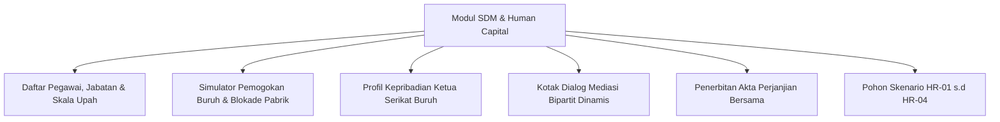

# PANDUAN PRAKTIKUM & TUTORIAL DOSEN SDM & HUBUNGAN INDUSTRIAL
## LABORATORIUM VLAB-ERP ENTERPRISE EDITION
## PROGRAM STUDI MANAJEMEN — UNIVERSITAS WIRA BHAKTI

---

### I. PERAN & FOKUS DOSEN SDM & HUBUNGAN INDUSTRIAL
Sebagai Dosen Pengampu Bidang **Manajemen SDM & Organisasi**, Anda bertanggung jawab memandu mahasiswa dalam:
1. Mengelola struktur kompensasi, perencanaan headcount tenaga kerja, dan alokasi shift produksi.
2. Menghadapi krisis pemogokan buruh massal (*Labor Strike Engine*) dan menyelenggarakan perundingan Bipartit yang humanis.
3. Memahami karakteristik profil pimpinan serikat buruh (*Union Leader Personalities*).
4. Menyusun dokumen hukum ketenagakerjaan resmi (*Akta Perjanjian Bersama Bipartit, Perjanjian Retensi Karyawan Kunci, Dokumen K3*).
5. Mengintegrasikan kebijakan SDM dengan produktivitas lini perakitan pabrik tanpa merusak struktur biaya tetap perusahaan (*Fixed Labor Overhead*).

---

### II. FITUR UTAMA MODUL SDM & BIPARTIT DI VLAB-ERP

#### 1. Manajemen Struktur Tenaga Kerja (*Employee Roster*)
- Akses melalui Menu Navigasi: **Portal ERP Mahasiswa $\rightarrow$ Modul SDM & Pegawai**.
- Menampilkan data karyawan lengkap dengan NIK, Departemen (Produksi, QC, Gudang, Engineering, Administrasi), Gaji Pokok, Tunjangan, Status Kepegawaian, dan Indeks Kinerja/Moral.

#### 2. Profil Pemimpin Serikat Buruh (*Union Personality Engine*)
VLab-ERP menghadirkan 3 arketipe pemimpin serikat pekerja yang realistis:
1. **Bambang Sukirman — Ketua Dewan Pengurus SP-Mandiri (Bebal & Militan)**:
   - *Karakter*: Garang, tidak mudah berkompromi, toleransi sangat rendah.
   - *Syarat Damai*: Kenaikan upah minimal $\ge 12\%$ dan bonus saku tunai $\ge \text{Rp 1.500.000}$ per orang.
   - *Respon Penolakan*: "Tawaran penghinaan macam apa ini?! Direksi makan enak buruh disuruh puasa! Negosiasi DITOLAK! Kami perpanjang mogok kerja!"
2. **Agus Prasetyo — Koordinator Forum Komunikasi Pekerja Pabrik (Manut & Kooperatif)**:
   - *Karakter*: Sangat memahami kondisi kas perusahaan, toleransi tinggi.
   - *Syarat Damai*: Kenaikan upah $\ge 5\%$ dan bonus saku $\ge \text{Rp 500.000}$ per orang.
   - *Respon Penerimaan*: "Terima kasih atas kebijaksanaan manajemen! Seluruh pekerja siap lembur malam ini mengejar target pesanan!"
3. **Hendra Wijaya — Ketua Presidium Aliansi Buruh Bersatu (Skeptikal & Pragmatis)**:
   - *Karakter*: Berorientasi bukti hitam di atas putih dan kepastian pencairan kas langsung.
   - *Syarat Damai*: Kenaikan upah $\ge 8\%$ dan uang saku tunai $\ge \text{Rp 1.000.000}$ per orang.

---

### III. POHON KEPUTUSAN SKENARIO SDM (DOMAIN HR)

Dosen SDM mengampu **4 Skenario Strategis** pada tab **Pohon Keputusan Multi-Skenario**:

| Kode | Judul Skenario | Konteks Masalah | Pilihan Cabang & Dampak Domino |
| :--- | :--- | :--- | :--- |
| **HR-01** | **Mogok Kerja Massal Serikat Buruh (Tuntutan Upah & Bonus)** | 40 pekerja memblokir gerbang pabrik menuntut kenaikan upah 12% dan uang saku damai Rp 1.5 Juta/orang. Lini produksi terhenti. | • **Cabang A**: Kesepakatan Bipartit (Upah naik 7% + Bonus Rp 24 Juta, Pabrik buka 100%, terbit *Perjanjian Bipartit No. 008*). • **Cabang B**: Tolak & Rekrut Outsourcing (Biaya Rp 16 Juta, Sengketa ke PHI, Defect rate naik 15%). • **Cabang C**: Uang saku tunai sekali bayar Rp 12 Juta tanpa naikkan upah pokok (Hemat fixed cost jangka panjang, tensi mereda). |
| **HR-02** | **Pembajakan (Poaching) Kepala Engineer Litbang** | Lead Engineer dan teknisi kunci ditawari kenaikan gaji 40% oleh kompetitor multinasional. | • **Cabang A**: Counter-Offer: Naik gaji 25% + Bonus Retensi (Biaya Rp 15 Juta, Tim R&D bertahan, terbit *Retention Agreement*). • **Cabang B**: Lepas karyawan & Tuntut Non-Compete Agreement (Hemat kas, namun inovasi produk baru tertunda 3 bulan). |
| **HR-03** | **Otomasi Robotik & Reskilling 10 Pekerja Packing** | Otomasi mesin perakitan menggantikan 10 posisi manual. Perusahaan harus menentukan nasib 10 pekerja. | • **Cabang A**: Pelatihan Reskilling menjadi Operator QC Robotik (Biaya modul Rp 14 Juta, Zero Layoff, Kapasitas lini naik 40%). • **Cabang B**: Pensiun Dini Sukarela (Golden Shakehand) (Biaya pesangon Rp 35 Juta, Struktur headcount berkurang permanen). |
| **HR-04** | **Kecelakaan Kerja di Pergudangan (Forklift Incident)** | Forklift rem blong menabrak rak, melukai staf gudang dan merusak persediaan senilai Rp 8 Juta. | • **Cabang A**: Tanggung Pengobatan VIP, Santunan & Audit Gudang (Biaya Rp 12 Juta, Kepercayaan buruh tinggi, terbit *Laporan K3*). • **Cabang B**: Klaim standar BPJS Ketenagakerjaan saja (Biaya Rp 2 Juta, Buruh mempertanyakan kepedulian moral manajemen). |

---

### IV. PANDUAN PRAKTIKUM MINGGU KE-9 S.D MINGGU KE-11

#### Pertemuan 9: Pemicu Pemogokan Buruh & Analisis Kerugian Downtime
1. **Aktivitas Dosen**: Buka **Konsol Dosen $\rightarrow$ Slider Simulasi $\rightarrow$ Naikkan Risiko *Labor Strike Risk* ke $80\%$**.
2. **Pengamatan Mahasiswa**: Mahasiswa akan melihat banner merah krisis pemogokan buruh di dashboard, status `is_strike_active = true`, dan lini produksi manufaktur terkunci (*bottleneck zero output*).
3. **Analisis Mahasiswa**: Hitung potensi kerugian harian pabrik (Rp 15 Juta/hari) vs biaya kompensasi tuntutan serikat pekerja.

#### Pertemuan 10: Perundingan Bipartit Humanis & Penerbitan Dokumen Resmi
1. **Instruksi ke Mahasiswa**: Buka modul SDM $\rightarrow$ Sub-fitur Mediasi Bipartit.
2. **Simulasi Tawar-Menawar**: Mahasiswa memasukkan persentase kenaikan upah (misal: 7%) dan nominal bonus saku (misal: Rp 1.000.000).
3. **Hasil Mediasi**: Jika tawaran memenuhi batas toleransi ketua serikat, pemogokan dicabut seketika, moral pekerja pulih ke $95\%$, dan sistem menerbitkan **Akta Perjanjian Bersama Bipartit No. 008/BIP-DISNAKER/2026**.
4. **Verifikasi Dosen**: Periksa apakah kelompok telah mengunduh dokumen resmi tersebut dan memverifikasi pencatatan beban gaji di modul Akuntansi.

#### Pertemuan 11: Manajemen Talenta, K3 & Keputusan Etis Reskilling
1. **Instruksi ke Mahasiswa**: Buka tab **Pohon Keputusan Multi-Skenario $\rightarrow$ Filter SDM $\rightarrow$ Selesaikan Skenario HR-02, HR-03, dan HR-04**.
2. **Debat Kelas**: Diskusikan nilai humanis Universitas Wira Bhakti: mengapa opsi *Reskilling Karyawan* (Cabang A pada HR-03) lebih mencerminkan kepemimpinan beretika dibanding pemecatan massal (*Layoff*).

---

### V. RUBRIK PENILAIAN PRAKTIKUM DOSEN SDM

| Kriteria Penilaian | Indikator Ketercapaian | Bobot |
| :--- | :--- | :---: |
| **Keberhasilan Mediasi Bipartit** | Pemogokan buruh selesai dalam $\le 2$ putaran negosiasi, moral kerja $\ge 90\%$, lini produksi beroperasi normal. | 35% |
| **Keseimbangan Biaya Tenaga Kerja** | Kenaikan beban upah bulanan tidak melebihi kapasitas laba operasional kelompok ($< 10\%$). | 25% |
| **Penyelesaian Skenario Kasus Ketenagakerjaan** | Eksekusi tepat pada skenario HR-01 s.d HR-04 disertai penerbitan dokumen hukum resmi. | 25% |
| **Penerapan Prinsip Etika & Humanisme** | Pemilihan solusi yang menjunjung tinggi keselamatan kerja (K3) dan pengembangan kapasitas manusia (*Reskilling*). | 15% |
| **TOTAL** | | **100%** |
