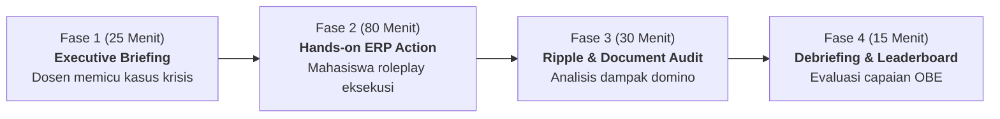
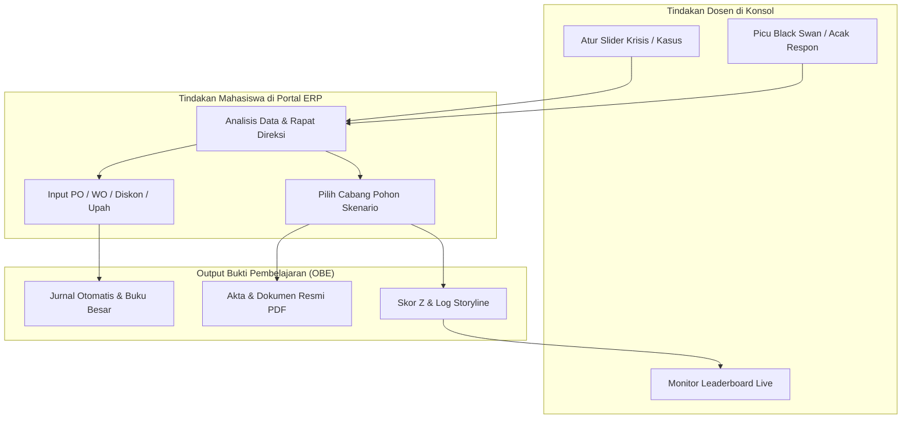
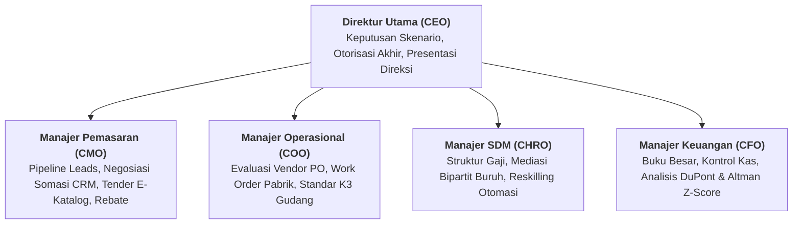

# PEDOMAN INTEGRASI OPERASIONAL VLAB-ERP DALAM PROSES BELAJAR MENGAJAR
## LABORATORIUM SIMULASI BISNIS DIGITAL & ERP TERINTEGRASI
## PROGRAM STUDI MANAJEMEN — UNIVERSITAS WIRA BHAKTI

---

### I. METODOLOGI PEMBELAJARAN: SIKLUS 150 MENIT PER PERTEMUAN (3 SKS)

Setiap sesi perkuliahan 3 SKS (150 menit) di Laboratorium Komputer / Bisnis Digital FEB Universitas Wira Bhakti dijalankan dengan struktur terstandar berbasis **Problem-Based Learning (PBL)** dan **Active Gamified Simulation**:

| Alokasi Waktu | Tahapan Aktivitas | Peran Dosen Pengampu | Aktivitas Mahasiswa (Kelompok Praktikan) | Modul VLab-ERP Terlibat |
| :--- | :--- | :--- | :--- | :--- |
| **00 – 25 Menit** | **1. Executive Briefing & Triggering Krisis** | • Menjelaskan teori manajerial singkat (15 menit). • Mengatur slider krisis di Konsol Dosen (misal: *Supply Disruption* 50%, *Labor Strike* 70%, atau mengacak komplain pelanggan). | • Menyimak arahan dosen. • Login ke Portal ERP Mahasiswa menggunakan akun kelompok masing-masing. • Meninjau kondisi awal kas (Rp 500 Juta) dan dashboard eksekutif. | Konsol Dosen (Slider Krisis) & Dashboard Portal Mahasiswa |
| **25 – 105 Menit** | **2. Active Hands-On Simulation & Problem Solving** | • Mengamati dinamika kelompok secara live. • Berkeliling memfasilitasi diskusi strategis mahasiswa. • Memantau log transaksi yang masuk ke backend secara real-time. | • **Direktur Utama (CEO)**: Memimpin rapat direksi kelompok. • **Manajer Pengadaan**: Menghitung HPP, memilih vendor, menerbitkan Purchase Order (PO). • **Manajer Pabrik**: Menjalankan Work Order (WO) perakitan barang jadi. • **Manajer Pemasaran**: Menangani komplain, negosiasi somasi, tender e-katalog. • **Manajer SDM**: Mediasi Bipartit serikat buruh. • **Manajer Keuangan**: Memantau arus kas dan buku besar. | Modul Purchasing, MRP Pabrik, CRM Pelanggan, SDM Pegawai, dan Akuntansi |
| **105 – 135 Menit**| **3. Domino Ripple Observation & Legal Verification** | • Membimbing mahasiswa menelaah hubungan sebab-akibat lintas fungsi. • Menginstruksikan mahasiswa mengunduh dokumen legal yang diterbitkan sistem. | • Membuka notifikasi pop-up **Domino Ripple Effect**. • Memeriksa dampak keputusan ke departemen lain (misal: Diskon CRM $\rightarrow$ Beban Laba Rugi Finance). • Membuka dan mencetak **Dokumen Resmi Bisnis** (*Addendum Kontrak, Akta Bipartit, SSP Pajak*). • Menganalisis kartu **Smart CFO: DuPont & Altman Z-Score**. | Tab Misi Hub, Modal Dokumen Resmi, dan Smart CFO Dashboard |
| **135 – 150 Menit**| **4. Cross-Team Debriefing & Live Leaderboard** | • Menampilkan **Live Leaderboard & Competency Radar** di layar proyektor kelas. • Membedah kelompok dengan kinerja terbaik (*Best Practice*) vs kelompok dalam zona bahaya (*Distress Zone*). • Memberikan umpan balik konstruktif dan refleksi OBE. | • Membandingkan peringkat valuasi dan skor CSAT/Moral kelompoknya terhadap kompetitor kelas. • Mencatat evaluasi untuk perbaikan periode simulasi berikutnya. | Konsol Dosen (Leaderboard & Radar Kompetensi) |

---

### II. MATRIKS INTEGRASI OPERASIONAL MINGGUAN (AKTIVITAS DOSEN VS MAHASISWA)

Berikut adalah panduan teknis langkah-demi-langkah pengoperasian VLab-ERP untuk setiap minggu perkuliahan:

#### Minggu 1: Setup Korporasi, Pembagian Peran & Navigasi ERP
- **Dosen**: Buka Konsol Dosen $\rightarrow$ Buat Sesi Kelas Baru $\rightarrow$ Tambah Tim Dosen $\rightarrow$ Auto-Provisioning 4–6 Kelompok @ Rp 500 Juta.
- **Mahasiswa**: Login dengan user `mahasiswa` / pass `mhs123` $\rightarrow$ Bagi peran direksi (CEO, CFO, CMO, HRD, COO) $\rightarrow$ Tinjau neraca awal kas Rp 500.000.000.
- **Bukti Belajar**: Struktur organisasi kelompok terbentuk dan terdaftar di database.

#### Minggu 2: Perencanaan Kebutuhan Bahan Baku (MRP) & Pengadaan (PO)
- **Dosen**: Di Konsol Dosen, geser slider *Supply Disruption* ke 30% untuk menyimulasikan kelangkaan komponen.
- **Mahasiswa**: Buka **Modul Purchasing** $\rightarrow$ Bandingkan 3 vendor (lead time vs defect rate vs harga) $\rightarrow$ Terbitkan PO Motherboard, Casing, dan Pasif $\rightarrow$ Verifikasi kas keluar di modul Akuntansi.
- **Bukti Belajar**: Dokumen PO resmi tersimpan, mutasi akun `1010 Kas` berkurang dan `1030 Persediaan Bahan Baku` bertambah.

#### Minggu 3: Perintah Kerja Perakitan (Work Order) & Manajemen Work Centers
- **Dosen**: Geser slider *Machine Breakdown Risk* ke 20% untuk menyimulasikan potensi malfungsi mesin perakitan.
- **Mahasiswa**: Buka **Modul Manufaktur (MRP)** $\rightarrow$ Input kuantitas Work Order (misal: 30 unit) $\rightarrow$ Alokasikan ke Work Center SMT $\rightarrow$ Pantau waktu siklus perakitan.
- **Bukti Belajar**: Jurnal mutasi persediaan Bahan Baku (WIP) ke Barang Jadi (FG) terbentuk otomatis di Buku Besar.

#### Minggu 4: Analisis Temperamen Konsumen & Mitigasi Somasi CRM
- **Dosen**: Buka Konsol Dosen $\rightarrow$ Klik tombol **"Acak Respon Pelanggan"** pada tiket komplain PT Megatama untuk memunculkan karakter pemarah (*Annoyingly Angry*).
- **Mahasiswa**: Buka **Modul CRM** $\rightarrow$ Baca narasi ancaman somasi $\rightarrow$ Buka modal mediasi $\rightarrow$ Tawarkan diskon kompensasi 15% + kunjungan teknisi onsite $\rightarrow$ Status berubah menjadi `Resolved` dan skor CSAT naik ke $> 88\%$.
- **Bukti Belajar**: Tiket CRM teresolusi, Credit Note terbit memotong saldo piutang.

#### Minggu 5: Tender Pengadaan Pemerintah (E-Katalog B2G)
- **Dosen**: Instruksikan mahasiswa membuka skenario **CRM-02** pada tab Pohon Keputusan.
- **Mahasiswa**: Buka **Misi Hub $\rightarrow$ Pohon Keputusan Multi-Skenario $\rightarrow$ CRM-02** $\rightarrow$ Analisis kecukupan kas jaminan bank garansi (Cabang A) vs Kemitraan Konsorsium KSO (Cabang B) $\rightarrow$ Eksekusi cabang terpilih.
- **Bukti Belajar**: Log peristiwa story event tercatat, dokumen *Pakta Integritas Tender E-Katalog* diterbitkan.

#### Minggu 6: Pengelolaan Kebijakan Kredit & Tenor Pembayaran (TOP 90 Hari)
- **Dosen**: Geser slider *Bad Debt Risk* ke 25% di Konsol Dosen.
- **Mahasiswa**: Buka **Skenario CRM-03** $\rightarrow$ Evaluasi permohonan TOP 90 hari distributor $\rightarrow$ Pilih opsi syarat penyerahan Bilyet Giro Mundur & biaya bunga 2% $\rightarrow$ Pantau rasio Days Sales Outstanding (DSO) di modul Akuntansi.
- **Bukti Belajar**: Dokumen *Addendum Perjanjian Fasilitas Kredit No. 062* terbit.

#### Minggu 7: Kampanye Pemasaran Digital & Program Rebate Reseller
- **Dosen**: Tinjau perolehan omzet seluruh kelompok di Leaderboard.
- **Mahasiswa**: Buka **Modul CRM $\rightarrow$ Kampanye Marketing** $\rightarrow$ Alokasikan budget promosi Rp 20 Juta $\rightarrow$ Buka **Skenario CRM-04** dan aktifkan program Year-End Rebate 5% $\rightarrow$ Amati lonjakan konversi Leads menjadi Sales Order.
- **Bukti Belajar**: Sales Order baru terkonversi, laporan omzet kuartalan meningkat 28%.

#### Minggu 8: Evaluasi Tengah Semester (UTS - Ujian Kasus Lapangan)
- **Tim Dosen**: Memberikan skenario krisis gabungan (Vendor gagal kirim + Komplain kritis serentak) $\rightarrow$ Menguji kemampuan reaksi kelompok dalam 60 menit.
- **Mahasiswa**: Mengeksekusi instruksi operasional di modul terkait $\rightarrow$ Mengklik **"Validasi & Selesaikan Kasus"** $\rightarrow$ Menerima penilaian otomatis sistem (0–100 pts) dan grading grade A/B/C.
- **Bukti Belajar**: Nilai UTS otomatis terekam di sistem dan matriks ketercapaian langkah (*Step Scores*) tersimpan.

#### Minggu 9: Penanganan Pemogokan Buruh Pabrik (Labor Strike)
- **Dosen**: Buka Konsol Dosen $\rightarrow$ Naikkan slider *Labor Strike Risk* ke 80% $\rightarrow$ Banner krisis mogok aktif di portal mahasiswa.
- **Mahasiswa**: Buka **Modul SDM** $\rightarrow$ Telaah profil Ketua Serikat Buruh (Bambang Sukirman / Agus Prasetyo / Hendra Wijaya) $\rightarrow$ Amati lini perakitan manufaktur yang terkunci $\rightarrow$ Hitung batas toleransi kas untuk kenaikan upah.
- **Bukti Belajar**: Log status pemogokan buruh dan analisis kerugian downtime harian.

#### Minggu 10: Perundingan Bipartit Humanis & Penerbitan Dokumen Resmi
- **Dosen**: Mengamati jalannya mediasi Bipartit di kelas.
- **Mahasiswa**: Buka kotak mediasi Bipartit $\rightarrow$ Tawarkan kenaikan upah 7% + bonus uang saku damai Rp 1.000.000 $\rightarrow$ Serikat buruh menerima kesepakatan $\rightarrow$ Blokade mesin terbuka seketika dan moral pekerja naik ke 95%.
- **Mahasiswa**: Buka notifikasi ripple $\rightarrow$ Klik **"Lihat Dokumen Resmi Diterbitkan"** $\rightarrow$ Unduh **Akta Perjanjian Bersama Bipartit No. 008/BIP-DISNAKER/2026**.
- **Bukti Belajar**: Akta Perjanjian Bersama Bipartit berstempel legal digital tersimpan di log dokumen kelompok.

#### Minggu 11: Keselamatan Kerja (K3), Retensi Talenta & Alih Keterampilan
- **Dosen**: Memicu insiden kecelakaan kerja atau penawaran pembajakan talenta.
- **Mahasiswa**: Eksekusi **Skenario HR-02** (Counter-offer retensi insinyur) dan **Skenario HR-03** (Reskilling 10 pekerja packing menjadi operator robotik tanpa PHK).
- **Bukti Belajar**: Dokumen *Retention Agreement No. 051* dan *SK Program Alih Kompetensi No. 035* terbit.

#### Minggu 12: Audit Laporan Keuangan Neraca, Laba Rugi & Modal Kerja
- **Dosen**: Buka Modul Akuntansi bersama mahasiswa di proyektor.
- **Mahasiswa**: Buka **Modul Akuntansi $\rightarrow$ Neraca Saldo & Laba Rugi** $\rightarrow$ Rekonsiliasi seluruh jurnal transaksi $\rightarrow$ Hitung Net Working Capital: $\text{NWC} = \text{Aset Lancar} - \text{Liabilitas Lancar}$.
- **Bukti Belajar**: Laporan keuangan audited periode berjalan tervalidasi imbang (*balanced*).

#### Minggu 13: Dekomposisi DuPont 3-Faktor di Smart CFO Dashboard
- **Dosen**: Menjelaskan korelasi antara Margin Laba, Perputaran Aset, dan Leverage Keuangan terhadap ROE.
- **Mahasiswa**: Buka **Misi Hub $\rightarrow$ Sub-Tab Smart CFO: DuPont & Altman Z-Score** $\rightarrow$ Analisis kartu interaktif 3 faktor pengali ROE $\rightarrow$ Rumuskan rekomendasi perbaikan efisiensi aset.
- **Bukti Belajar**: Tangkapan layar analisis dekomposisi DuPont dan formulasi target ROE $> 15\%$.

#### Minggu 14: Prediksi Kebangkrutan Altman Z-Score & Sengketa Pajak SKPKB
- **Dosen**: Klik tombol **"Guncangan Black Swan"** di portal untuk menerbitkan SKPKB Pajak Rp 25 Juta atau gagal bayar piutang.
- **Mahasiswa**: Buka **Skenario ACC-01** $\rightarrow$ Bayar lunas SKPKB Rp 25 Juta $\rightarrow$ Buka **Skenario ACC-03** untuk restrukturisasi pinjaman bank agar Current Ratio tetap $> 1.5\text{x}$ $\rightarrow$ Pantau posisi gauge Altman Z tetap berada di **Safe Zone ($Z \ge 2.90$)**.
- **Bukti Belajar**: Dokumen *Surat Setoran Pajak (SSP) No. 082* dan *Addendum Kredit Bank No. 093* tersimpan.

#### Minggu 15: Open Sandbox Integrasi 20 Skenario Bebas
- **Tim Dosen**: Membuka seluruh domain skenario $\rightarrow$ Mengizinkan kelompok mengambil keputusan strategis bebas untuk memaksimalkan valuasi perusahaan.
- **Mahasiswa**: Menyelesaikan skenario tersisa pada domain Purchasing, Manufacturing, CRM, HR, dan Accounting $\rightarrow$ Memantau efek domino multi-level pada arus kas dan reputasi pasar.
- **Bukti Belajar**: Log kronologi lengkap (*Storyline*) berisi seluruh riwayat keputusan dan portofolio dokumen hukum korporasi.

#### Minggu 16: Evaluasi Akhir Semester (UAS - Grand Enterprise Showcase)
- **Tim Dosen**: Duduk sebagai Dewan Komisaris / Investor Panelis $\rightarrow$ Menilai presentasi pertanggungjawaban direksi tiap kelompok.
- **Mahasiswa**: Mempresentasikan:
  1. Kinerja Finansial (Laba Bersih, Arus Kas, Analisis DuPont & Altman Z-Score).
  2. Kinerja Pemasaran & CRM (Pertumbuhan Omzet, Penanganan Somasi, CSAT).
  3. Kinerja Human Capital (Harmonisasi Bipartit, Moral Pekerja, Program K3).
  4. Portofolio Dokumen Hukum Bisnis yang Diterbitkan Sepanjang Simulasi.
- **Bukti Belajar**: Nilai akhir akumulasi OBE (Skor Transaksi 20% + Misi Kasus 25% + UTS 15% + Portofolio Dokumen 20% + UAS 20%).

---

### III. PEMBAGIAN PERAN MAHASISWA DALAM KELOMPOK (ROLE PLAYING GUIDE)

Agar simulasi berjalan interaktif dan seluruh anggota kelompok berpartisipasi aktif:

---

### IV. MEKANISME ASESMEN OTOMATIS & REKAPITULASI NILAI DI VLAB-ERP

Dosen tidak perlu melakukan koreksi manual berbasis kertas. VLab-ERP menyediakan 3 instrumen asesmen otomatis:
1. **Live Leaderboard & Competency Radar**: Menghitung secara real-time bobot performa finansial (30%), kepuasan pelanggan CSAT (25%), efisiensi operasional pabrik (25%), dan moral SDM (20%).
2. **Dynamic Step-by-Step Scoring Engine**: Menguji pemenuhan kriteria solusi mahasiswa pada setiap kasus (misal: apakah PO sudah terbit? apakah jurnal sudah seimbang? apakah somasi sudah dicabut?) dengan nilai instan 0–100 pts.
3. **Storyline Audit Trail**: Menampilkan histori seluruh keputusan cabang yang diambil kelompok beserta jam, biaya kas, dan dokumen hukum yang diterbitkan.
