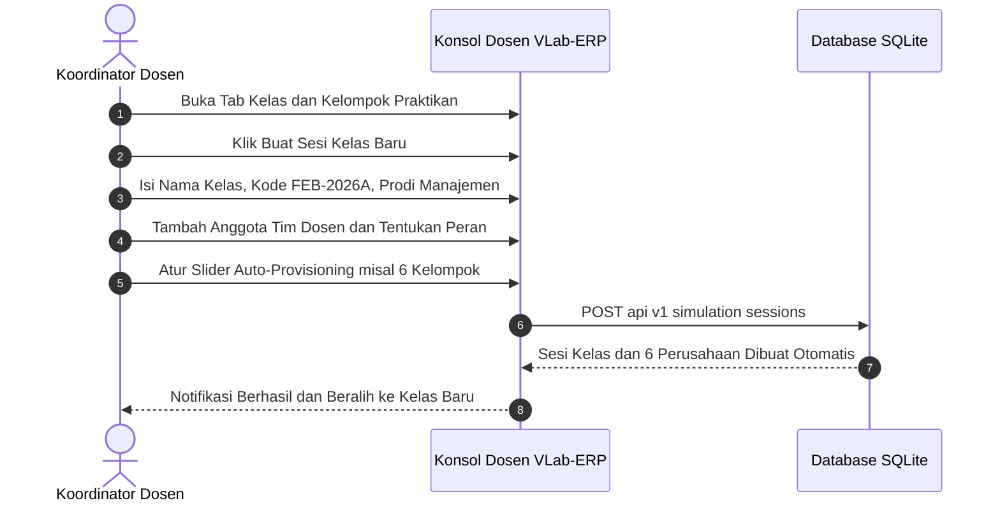

# PANDUAN KOORDINATOR MATA KULIAH & TEAM TEACHING FEB
## SISTEM MULTI-KELAS & MULTI-DOSEN VLAB-ERP ENTERPRISE EDITION
## PROGRAM STUDI MANAJEMEN — UNIVERSITAS WIRA BHAKTI

---

### I. TUGAS & WEWENANG KOORDINATOR MATA KULIAH
Sebagai **Koordinator Mata Kuliah & Pengampu Utama**, Anda memegang kendali administratif dan pedagogis penuh atas:
1. Pembuatan dan pengelolaan seluruh Sesi Kelas Paralel (misal: *Kelas Reguler Pagi FEB-A*, *FEB-B*, *FEB-C*, *Kelas Karyawan/Eksekutif*).
2. Penyusunan susunan tim dosen pengampu (*Team Teaching Builder*) per kelas, menetapkan peran spesifik (Pemasaran, SDM, Keuangan, Manufaktur).
3. Pengaturan *Auto-Provisioning* kelompok mahasiswa (2–12 tenant perusahaan per kelas @ Rp 500 Juta).
4. Penggunaan fitur **1-Click Class Duplicator (Clone)** untuk menduplikasi setup kelas dengan cepat.
5. Manajemen akun dan reset password praktikan/dosen (*User & Password CRUD*).
6. Kustomisasi branding institusi (*White-label* FEB Universitas Wira Bhakti).

---

### II. ALUR KERJA KOORDINATOR SEBELUM PERKULIAHAN DIMULAI

---

### III. PANDUAN OPERASIONAL FITUR UTAMA KONSOL DOSEN

#### 1. Membuat Sesi Kelas Baru dengan Team Dosen Builder
1. Buka **Portal Konsol Dosen $\rightarrow$ Tab 2: Kelas & Kelompok Praktikan**.
2. Klik tombol **"+ Buat Sesi Kelas Baru"**.
3. Lengkapi formulir:
   - **Nama Sesi Kelas**: Contoh: `Manajemen Bisnis Digital (FEB-A)`.
   - **Kode Sesi Unik**: Contoh: `MNJ-A-2026`.
   - **Program Studi**: `S1 Manajemen`.
   - **Tahun Akademik**: `Semester Ganjil 2026/2027`.
4. **Susunan Tim Dosen (Team Teaching)**:
   - Klik **"+ Tambah Dosen ke Tim"**.
   - Pilih nama dosen dari *dropdown* akun terdaftar.
   - Pilih peran: *Koordinator Utama*, *Dosen Bidang Pemasaran & CRM*, *Dosen Bidang SDM & Hubungan Industrial*, atau *Dosen Bidang Keuangan & Akuntansi*.
   - Centang **"Koordinator Utama"** untuk dosen penanggung jawab kelas.
5. **Auto-Provisioning Perusahaan Praktikan**:
   - Geser slider jumlah kelompok (misal: 4, 6, 8, atau 12 kelompok).
   - Centang **"Generate Kasus Berbeda Tiap Kelompok"** agar setiap kelompok menerima studi kasus yang unik.
6. Klik **"Simpan & Buat Sesi Kelas"**. Sistem secara instan membuatkan database perusahaan, bagan akun, inventaris awal, dan akun tim perwakilan mahasiswa!

#### 2. Fitur Duplikasi 1-Klik (*1-Click Class Duplicator*)
Untuk membuat kelas paralel baru (misal: membuat Kelas FEB-B dengan setting yang sama persis seperti FEB-A):
1. Temukan kartu kelas yang ingin diduplikasi.
2. Klik tombol **"Duplikasi / Clone"** (ikon salin).
3. Masukkan nama kelas baru (misal: `Manajemen Bisnis Digital (FEB-B)`) dan kode baru (misal: `MNJ-B-2026`).
4. Klik **"Ya, Gandakan Kelas Ini"**. Seluruh konfigurasi tim dosen, slider skenario, dan modul kelompok akan terduplikasi sempurna dalam 1 detik!

#### 3. Beralih Kelas Secara Cepat (*Quick Class Switcher*)
Di bagian atas header Konsol Dosen, terdapat menu *dropdown* **"Sesi Kelas Aktif"**. Mengubah pilihan kelas di sini akan secara instan memperbarui:
- Daftar kelompok praktikan yang sedang dikelola.
- Papan peringkat nilai (*Leaderboard*) kelas tersebut.
- Pengaturan slider skenario untuk kelas yang bersangkutan.

#### 4. Manajemen Akun & Reset Password Mahasiswa
1. Buka **Konsol Dosen $\rightarrow$ Tab 5: Manajemen Akun & Hak Akses**.
2. Anda dapat melihat daftar seluruh akun mahasiswa, dosen, dan admin.
3. Gunakan filter berdasarkan Kelas Sesi atau Role.
4. Klik tombol **"Ganti Password"** (ikon kunci) pada akun mahasiswa yang lupa kata sandi, lalu pilih preset:
   - `mhs123` untuk mahasiswa.
   - `dosen123` untuk dosen.
   - `admin123` untuk staf laboratorium.
5. Klik **"Simpan Password"**.

#### 5. Kustomisasi Branding FEB (*White-Label FEB Wira Bhakti*)
1. Buka **Konsol Dosen $\rightarrow$ Tab 4: Kustomisasi & Branding FEB**.
2. Anda dapat mengubah teks kop resmi, nama fakultas, nama koordinator, semester aktif, hingga teks footer sistem.
3. Klik **"Simpan Pengaturan Branding"** agar seluruh portal mahasiswa menampilkan identitas Universitas Wira Bhakti secara konsisten.

#### 6. Injeksi Disrupsi Pasar Dadakan (*Dosen Live Surprise Event Injections*)
Dosen pengampu dapat menguji ketahanan mental manajerial mahasiswa dengan menyuntikkan kejadian tak terduga secara serentak (*broadcast injection*):
1. Buka **Konsol Dosen $\rightarrow$ Tab 1: Skenario & Disrupsi Pasar**.
2. Pilih jenis disrupsi yang ingin diaktifkan:
   - **Krisis Kelangkaan Semikonduktor Global** (Biaya PO naik +40%, lead time molor).
   - **Lonjakan Inflasi & Upah Minimum** (Buruh menuntut kenaikan gaji darurat).
   - **Surat Peringatan Pajak SKPKB** (Tagihan pajak tertunggak dengan denda keterlambatan).
   - **Somasi Hukum Klien VIP** (Risiko denda penalti Rp 150 Juta jika gagal mediasi).
3. Klik tombol **"⚡ Tembakkan Disrupsi ke Seluruh Kelompok"**.
4. Seketika seluruh dashboard mahasiswa akan menerima notifikasi darurat dan indikator keuangan mereka terpengaruh secara berantai!

#### 7. Pemantauan Takdir Akhir Kelompok (*Live Multi-Ending Predictor*)
Pada papan peringkat (*Leaderboard*), Dosen dapat melihat ramalan takdir akhir (*Multi-Ending Archetype*) dari masing-masing kelompok:
- 💀 **Likuidasi Kebangkrutan** (Kas defisit / Altman Z < 1.1)
- 🛑 **Mogok Kerja Total** (Moral buruh hancur / Negosiasi buntu)
- 📉 **Skandal Mutu** (Komplain cacat meledak / CSAT anjlok)
- 🏢 **Korporasi Zombie** (Stagnasi tanpa pertumbuhan)
- 🔄 **Restrukturisasi Utang** (Pemulihan krisis)
- 🛡️ **Mitra Terpercaya** (Operasi sehat & CSAT > 85%)
- 🏆 **Konglomerasi Unicorn Apex** (Laba maksimal & Altman Z > 3.0)

---

### IV. REKOMENDASI TATA KELOLA KELAS PER SEMESTER

| Minggu Perkuliahan | Tugas Koordinator & Jadwal Dosen |
| :--- | :--- |
| **Minggu 1 – 3** | • Koordinator membuat sesi kelas FEB-A/B/C dan memverifikasi login kelompok mahasiswa. • Koordinator mengisi materi pengantar ERP, MRP, dan Pengadaan (PO). |
| **Minggu 4 – 7** | • Rotasi ke **Dosen Pemasaran & CRM**. • Dosen Pemasaran memandu kasus komplain kritis, tender e-katalog, dan kebijakan kredit. |
| **Minggu 8 (UTS)** | • Seluruh tim dosen hadir menguji praktikum audit transaksi kelompok. |
| **Minggu 9 – 11** | • Rotasi ke **Dosen SDM & Organisasi**. • Dosen SDM memicu krisis mogok buruh dan menguji mediasi Bipartit kelompok. |
| **Minggu 12 – 14** | • Rotasi ke **Dosen Keuangan & Akuntansi**. • Dosen Keuangan membedah laporan laba rugi, DuPont 3-Faktor, dan Altman Z-Score. |
| **Minggu 15 – 16 (UAS)**| • Seluruh tim dosen menguji simulasi disrupsi terbuka dan presentasi pertanggungjawaban tahunan (*Grand Showcase*). |

