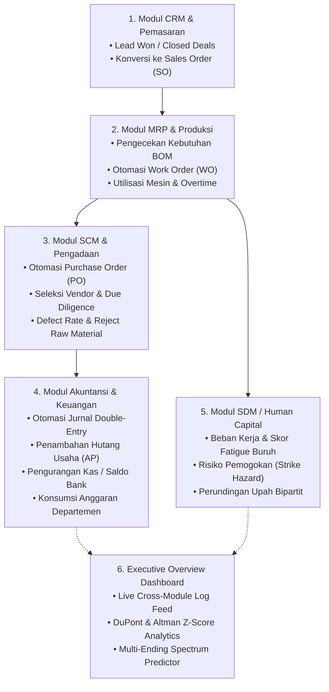

# RENCANA PEMBELAJARAN SEMESTER (RPS) BERBASIS OUTCOME-BASED EDUCATION (OBE)
## PROGRAM STUDI S1 MANAJEMEN — FAKULTAS EKONOMI DAN BISNIS
## UNIVERSITAS WIRA BHAKTI

---

### I. VISI & MISI PROGRAM STUDI MANAJEMEN UNIVERSITAS WIRA BHAKTI

**Visi 2044**:
> *"Menjadi Program Studi Manajemen yang unggul, inovatif, humanis, dan berbasis digital dalam pendidikan, penelitian, dan pengabdian di bidang manajemen, serta menjadi pelopor pendidikan kewirausahaan yang berdaya saing global pada tahun 2044."*

**Misi**:
1. Menyelenggarakan pendidikan manajemen yang bermutu untuk menghasilkan lulusan yang kompeten, adaptif terhadap perkembangan ilmu pengetahuan dan teknologi, serta berintegritas tinggi.
2. Melaksanakan penelitian yang inovatif dan aplikatif untuk pengembangan ilmu manajemen dan penyelesaian masalah nyata dalam dunia usaha dan masyarakat.
3. Mengimplementasikan pengabdian kepada masyarakat yang berkelanjutan dan berbasis hasil penelitian untuk meningkatkan kesejahteraan masyarakat.
4. Membangun jejaring kerjasama strategis dengan dunia usaha, pemerintah, dan lembaga pendidikan baik nasional maupun internasional guna mendukung tridharma perguruan tinggi.
5. Menumbuhkembangkan budaya kewirausahaan, kreativitas, dan inovasi di lingkungan akademik melalui kurikulum dan kegiatan kemahasiswaan berbasis digital.

---

### II. IDENTITAS MATA KULIAH

| Komponen | Keterangan |
| :--- | :--- |
| **Nama Mata Kuliah** | **Laboratorium Simulasi ERP & Manajemen Bisnis Digital Terintegrasi** |
| **Kode Mata Kuliah** | **MNJ-4108** |
| **Beban Satuan Kredit Semester (SKS)** | **3 SKS (Praktikum / Laboratorium Terpadu)** |
| **Semester / Tahun Akademik** | Ganjil / Genap (Semester V / VI) |
| **Rumpun Mata Kuliah** | Keterampilan Aplikasi Manajemen & Bisnis Digital |
| **Model Pembelajaran** | *Outcome-Based Education (OBE)* • *Problem-Based Learning (PBL)* • *Team-Teaching Rolling Modular* • *Multi-Ending Business Wargame* |
| **Platform Laboratorium** | **VLab-ERP Enterprise Edition** (Multi-Tenant Sandbox, End-to-End Cascading Ripple Engine, 7 Multi-Ending Archetypes, Double-Entry Accounting Automator, Dosen Live Event Injection) |
| **Dosen Koordinator Pengampu** | Koordinator Mata Kuliah & Pengampu Utama |
| **Dosen Anggota Tim Pengampu** | 1. Dosen Pengampu Bidang Pemasaran & CRM 2. Dosen Pengampu Bidang SDM & Hubungan Industrial 3. Dosen Pengampu Bidang Akuntansi & Manajemen Keuangan |

---

### III. CAPAIAN PEMBELAJARAN LULUSAN (CPL-PRODI) YANG DIBEBANKAN PADA MATA KULIAH

| Kode CPL | Deskripsi CPL (Diturunkan dari Visi-Misi Universitas Wira Bhakti) |
| :--- | :--- |
| **CPL-1 (Sikap & Humanis)** | Menunjukkan sikap bertakwa kepada Tuhan YME, menjunjung tinggi etika bisnis profesional, keadilan sosial, empati hubungan industrial (bipartit), dan tanggung jawab moral dalam setiap keputusan manajerial. |
| **CPL-2 (Pengetahuan Bisnis & Digital)** | Menguasai teori, konsep, dan prinsip integrasi fungsional lintas divisi (Pemasaran/CRM, Operasi/MRP, Pengadaan/SCM, SDM/HCM, Akuntansi/Keuangan) dengan arsitektur sistem informasi enterprise modern. |
| **CPL-3 (Keterampilan Khusus - Operasional & Rantai Pasok)** | Mampu merancang alur pengadaan bahan baku, menganalisis risiko mutu vendor (defect due diligence), menjadwalkan perintah kerja perakitan (Work Order), dan memitigasi bottleneck kapasitas mesin SMT. |
| **CPL-4 (Keterampilan Khusus - Pemecahan Masalah Domino)** | Mampu mendiagnosis masalah kasual bertingkat (*cascading ripple problems*), memitigasi dampak domino antar-departemen, serta mengeksekusi instrumen komersial dan dokumen hukum resmi (*Akta Perjanjian Bersama Bipartit, Surat Pesanan/PO, Surat Jalan/DO, Faktur Pajak*). |
| **CPL-5 (Keterampilan Umum - Analitika & Tata Kelola Keuangan)** | Mampu mengaudit buku besar, memantau *Double-Entry General Ledger*, menganalisis likuiditas kas, serta mengevaluasi kesehatan korporasi secara mandiri maupun kolaboratif menggunakan Analisis DuPont 3-Faktor dan Altman Z-Score Predictor. |

---

### IV. CAPAIAN PEMBELAJARAN MATA KULIAH (CPMK) & SUB-CPMK

#### A. Capaian Pembelajaran Mata Kuliah (CPMK)
- **CPMK-1**: Mampu memahami dan mengoperasikan arsitektur Enterprise Resource Planning (ERP) lintas divisi (Pengadaan, Produksi, CRM, SDM, Akuntansi) serta melacak dampak rantai transaksi otomatis (*Cascading Ripple Effect*) pada platform VLab-ERP. (CPL-2, CPL-4)
- **CPMK-2**: Mampu menganalisis profil risiko prospek pasar, menegosiasikan kontrak penjualan B2B, menyelesaikan somasi konsumen VIP, dan mengelola saluran pemasaran digital berorientasi kepuasan konsumen (CSAT). (CPL-1, CPL-3, CPL-4)
- **CPMK-3**: Mampu menyelesaikan sengketa ketenagakerjaan, merancang perundingan Bipartit yang humanis dengan serikat buruh, serta mengoptimalkan produktivitas pabrik tanpa mengorbankan moral pekerja dan regulasi K3. (CPL-1, CPL-3, CPL-4)
- **CPMK-4**: Mampu mengevaluasi laporan keuangan berkala, melakukan audit jurnal umum berpasangan (*Double-Entry*), mengelola modal kerja (*Working Capital*), serta mendiagnosis risiko kebangkrutan melalui Analisis DuPont dan Model Altman Z-Score. (CPL-2, CPL-5)
- **CPMK-5**: Mampu mengambil keputusan strategis di bawah tekanan 20 skenario disrupsi pasar dan kejutan dosen (*Dosen Event Trigger*), serta mengarahkan perusahaan mencapai spektrum akhir tertinggi (*Unicorn Apex Spectrum*). (CPL-1, CPL-3, CPL-4, CPL-5)

---

### V. ARSITEKTUR RANTAI INTEGRASI OTOMATIS (CASCADING RIPPLE ENGINE)

Platform VLab-ERP menerapkan arsitektur transaksi terintegrasi penuh. Keputusan pada satu modul akan memicu efek domino berantai pada modul lainnya secara otomatis:

---

### VI. SPEKTRUM 7 MULTI-ENDING SIMULASI PERUSAHAAN

Setiap keputusan strategis mahasiswa diakumulasikan oleh sistem kecerdasan VLab-ERP untuk menentukan takdir akhir perusahaan (*Multi-Ending Spectrum*):

| Archetype Ending | Ikon & Klasifikasi | Pemicu & Karakteristik Utama | Status Kelulusan Manajerial |
| :--- | :--- | :--- | :--- |
| **Ending 1** | 💀 **Likuidasi Kebangkrutan** | Kas negatif, default hutang vendor (AP macet), Altman Z-Score < 1.1 (*Distress Zone*). | *Critical Failure / Re-evaluasi* |
| **Ending 2** | 🛑 **Mogok Kerja Total** | Negosiasi bipartit buntu, upah di bawah standar, moral buruh < 30%, pabrik lumpuh total. | *Perlu Remediasi Hubungan Industrial* |
| **Ending 3** | 📉 **Skandal Mutu & Boikot** | Asal memilih vendor murah dengan cacat tinggi (>8%), komplain produk meledak, CSAT < 40%. | *Perlu Remediasi Manajemen Mutu* |
| **Ending 4** | 🏢 **Korporasi Zombie** | Perusahaan bertahan hidup tapi tidak berkembang, kas stagnan, margin laba sangat tipis. | *Lulus Bersyarat (Marginal Pass)* |
| **Ending 5** | 🔄 **Restrukturisasi Utang** | Berhasil bangkit dari krisis likuiditas melalui restrukturisasi modal dan efisiensi anggaran. | *Lulus Baik (Good Turnaround)* |
| **Ending 6** | 🛡️ **Mitra Industri Terpercaya** | Likuiditas terjaga, reputasi vendor prima, hubungan buruh harmonis, CSAT konsisten > 85%. | *Lulus Memuaskan (Superior Partner)* |
| **Ending 7** | 🏆 **Konglomerasi Unicorn Apex** | Laba bersih maksimal, nol pemogokan, skor Altman Z > 3.0, kepuasan pasar 95%+, ROE tertinggi. | *Lulus Istimewa (Apex Executive)* |

---

### VII. MODEL ROLLING TEAM-TEACHING (3 PILIHAN JALUR ROTASI MODULAR)

Untuk memberikan fleksibilitas penuh bagi Program Studi dan Tim Dosen Pengampu (misal: untuk kelas paralel FEB-A, FEB-B, dan FEB-C), RPS ini menyediakan **3 Pilihan Jalur Rolling Modular**:

```mermaid
flowchart TD
    subgraph TrackA["Jalur A: Market-Driven Track (Pemasaran Masuk Duluan)"]
        direction LR
        A1["Mg 1-3: Fondasi ERP & SCM<br>(Koordinator)"] --> A2["Mg 4-7: Pemasaran & CRM<br>(Dosen Pemasaran)"] --> AUTS["Mg 8: UTS"] --> A3["Mg 9-11: MSDM & Bipartit<br>(Dosen SDM)"] --> A4["Mg 12-14: Keuangan & CFO<br>(Dosen Keuangan)"] --> AUAS["Mg 15-16: UAS"]
    end

    subgraph TrackB["Jalur B: Human Capital-First Track (SDM Masuk Duluan)"]
        direction LR
        B1["Mg 1-3: Fondasi ERP & SCM<br>(Koordinator)"] --> B2["Mg 4-7: MSDM & Bipartit<br>(Dosen SDM)"] --> BUTS["Mg 8: UTS"] --> B3["Mg 9-11: Pemasaran & CRM<br>(Dosen Pemasaran)"] --> B4["Mg 12-14: Keuangan & CFO<br>(Dosen Keuangan)"] --> BUAS["Mg 15-16: UAS"]
    end

    subgraph TrackC["Jalur C: Financial Discipline Track (Keuangan Masuk Duluan)"]
        direction LR
        C1["Mg 1-3: Fondasi ERP & SCM<br>(Koordinator)"] --> C2["Mg 4-7: Keuangan & Budget<br>(Dosen Keuangan)"] --> CUTS["Mg 8: UTS"] --> C3["Mg 9-11: Pemasaran & CRM<br>(Dosen Pemasaran)"] --> C4["Mg 12-14: MSDM & Bipartit<br>(Dosen SDM)"] --> CUAS["Mg 15-16: UAS"]
    end
```

---

### VIII. RANCANGAN PEMBELAJARAN MINGGUAN (16 PERTEMUAN)

#### MATRIKS PEMBELAJARAN JALUR UTAMA (JALUR A: MARKET-DRIVEN)

| Mg | Sub-CPMK | Bahan Kajian / Topik | Metode & Aktivitas | Praktikum VLab-ERP & Skenario | Bobot |
|:---:|:---|:---|:---|:---|:---:|
| **1** | Orientasi Laboratorium ERP & Multi-Tenant Architecture | Visi FEB 2044, Pengenalan Konsep ERP Terintegrasi, Struktur Perusahaan Manufaktur Elektronik, Navigasi Modul VLab-ERP. | Kuliah Interaktif, Pembentukan Tim Direksi Kelompok | Setup Profil Perusahaan, Eksplorasi Master Data Produk & BOM. | 3% |
| **2** | Master Data, Bill of Materials (BOM) & Work Center | Manajemen Kapasitas Mesin SMT, Biaya Mesin per Jam, Kalkulasi Kebutuhan Bahan Baku (MRP I), Routing Produksi. | Diskusi Kasus & Simulasi Kalkulasi BOM | Input BOM Smart Device & Sensor Industri, Pengaturan Kapasitas Work Center. | 4% |
| **3** | Pengadaan Bahan Baku (SCM) & Evaluasi Mutu Vendor | Siklus Pembelian (PO), Analisis Rasio Cacat Vendor (Due Diligence Risiko Mutu), Penanganan Barang Reject di Gudang. | *Problem-Based Learning* (PBL) Pengadaan | Penerbitan PO Bahan Baku, Simulasi Kasus **SCM-01** (Seleksi Vendor Kritis). | 4% |
| **4** | Pipeline Penjualan CRM & Analisis Karakter Prospek | Siklus Leads to Cash, 4 Profil Karakter Prospek (Pemerintah B2G, Korporasi Multinasional, Distributor, Retail), Margin Penjualan. | Studi Kasus CRM & Negosiasi Penawaran | Hands-on Pipeline CRM, Estimasi Probabilitas Deal, Eksekusi Kasus **CRM-01**. | 5% |
| **5** | Konversi Sales Order & Otomasi Rantai MRP-PO | Integrasi Rantai Otomatis (Sales Order ➔ Cek Stok ➔ Auto Work Order ➔ Auto PO Bahan Baku), Manajemen Lead Time. | Simulasi Transaksi Rantai Pasok Terpadu | Konversi Deal CRM Menjadi SO, Pemantauan Log Audit Trail Eksekutif. | 5% |
| **6** | Mitigasi Somasi Komplain & Mediasi Konsumen VIP | Penanganan Klaim Mutu Produk Cacat dari Klien Korporat, Penyusunan Dokumen Addendum Perjanjian Komersial, Skor CSAT. | Simulasi Mediasi Sengketa Bisnis | Penerbitan Dokumen Addendum Ganti Rugi, Eksekusi Kasus **CRM-02** & **CRM-03**. | 5% |
| **7** | Kampanye Pemasaran Digital & Optimasi Konversi | Alokasi Anggaran Marketing Digital, Analisis ROI Kampanye Iklan, Perhitungan Biaya Akuisisi Pelanggan (CAC). | Praktikum Analitika Pemasaran | Peluncuran Kampanye Digital Ads, Eksekusi Kasus **CRM-04** (Tender E-Katalog). | 5% |
| **8** | **UJIAN TENGAH SEMESTER (UTS)** | **Evaluasi Pemecahan Masalah PBL Terintegrasi (Pengadaan, Produksi & CRM)** | **Ujian Kasus Simulasi Terarah & Audit Transaksi** | **Penyelesaian Skenario Krisis Tahap I & Verifikasi Log Pembukuan** | **15%** |
| **9** | Manajemen Human Capital & Profil Serikat Buruh | Struktur Penggajian Operator, Beban Lembur (*Overtime*), Analisis 3 Karakter Ketua Serikat Pekerja (Kooperatif, Militan, Normatif). | Kuliah Kasus Hubungan Industrial | Penyesuaian Upah Pokok & Bonus Kesejahteraan, Monitoring Skor Moral & Fatigue Buruh. | 5% |
| **10** | Perundingan Bipartit & Mitigasi Pemogokan Pabrik | Teknik Negosiasi Tripartit/Bipartit Berbasis Humanis, Penyusunan *Akta Perjanjian Bersama Bipartit* Berkekuatan Hukum. | *Role-Play* Negosiasi Meja Perundingan | Simulasi Ancaman Mogok Kerja Massal, Eksekusi Kasus **HR-01** & **HR-02**. | 5% |
| **11** | Keselamatan Kerja (K3) & Program Reskilling Operator | Standar Ergonomi Pabrik SMT, Program Pelatihan & Up-skilling Tenaga Kerja, Pencegahan Turnover Talenta Kunci. | Studi Kasus Kepatuhan K3 & Produktivitas | Alokasi Budget Pelatihan SDM, Eksekusi Kasus **HR-03** & **HR-04** (K3 & Kompensasi). | 5% |
| **12** | Akuntansi Double-Entry & Audit Jurnal Otomatis | Struktur Bagan Akun (COA), Jurnal Berpasangan Otomatis dari PO/SO, Buku Besar, Neraca Saldo, Laba Rugi Real-Time. | Praktikum Audit Pembukuan Digital | Penelusuran Jurnal Akuntansi dari Transaksi Operasional, Pelunasan AP Hutang Dagang. | 5% |
| **13** | Manajemen Likuiditas Kas & Plafon Anggaran Divisi | Manajemen Modal Kerja (*Working Capital*), Kontrol Defisit Anggaran Departemen, Penagihan Piutang Usaha (AR). | Analisis Arus Kas & Manajemen Likuiditas | Monitoring Konsumsi Anggaran Departemen, Eksekusi Kasus **ACC-01** & **ACC-02**. | 5% |
| **14** | Analisis Kesehatan Bisnis: DuPont & Altman Z-Score | Dekomposisi ROE (Margin Laba × Asset Turnover × Leverage Equity), Model Kebangkrutan Altman Z-Score, Audit Pajak SKPKB. | Analitika Finansial Eksekutif & Prediksi Krisis | Evaluasi Dashboard Smart CFO, Eksekusi Kasus **ACC-03** (Pajak) & **ACC-04** (Bank). | 6% |
| **15** | Simulasi Krisis Terbuka & Dosen Live Disruption | Penanganan Skenario Disrupsi Dadakan dari Dosen (*Supply Chain Shock, Macro Inflation, VIP Legal Threat*), Adaptasi Multi-Ending. | *Full Business Wargame* Lintas Divisi | Respon Cepat Terhadap Trigger Dosen, Mitigasi Risiko Kebangkrutan Kelompok. | 8% |
| **16** | **UJIAN AKHIR SEMESTER (UAS)** | **Grand Showcase & Rapat Umum Pemegang Saham (RUPS) Direksi** | **Presentasi Eksekutif di Hadapan Panelis Dosen** | **Evaluasi Skor Multi-Ending 7 Archetypes, Penyerahan Portofolio Dokumen Bisnis Resmi** | **15%** |

---

### IX. INSTRUMEN PENILAIAN OUTCOME-BASED EDUCATION (OBE)

| Komponen Penilaian | Bobot | Indikator Ketercapaian (Assessment Rubric) |
| :--- | :---: | :--- |
| **1. Keaktifan Praktikum & Log Audit Transaksi ERP** | **20%** | Kedisiplinan eksekusi transaksi (PO, WO, Jurnal Akuntansi), kelengkapan data operasional harian, dan ketertiban administrasi tanpa terjadi error integritas data. |
| **2. Evaluasi Pemecahan Masalah PBL (20 Skenario)** | **25%** | Ketepatan analisis akar masalah pada skenario CRM, SCM, HR, dan Finansial serta keefektifan mitigasi dampak domino antar-divisi. |
| **3. Ujian Tengah Semester (UTS - Kasus Operasional)** | **15%** | Kemampuan mandiri dalam menyelesaikan skenario operasional terpadu (Pengadaan bahan baku, mitigasi cacat, dan penutupan kontrak penjualan). |
| **4. Portofolio Dokumen Hukum & Bisnis Resmi** | **20%** | Kualitas dan keabsahan dokumen formal yang diterbitkan (*Akta Perjanjian Bersama Bipartit, Addendum Komplain CRM, Rekonsiliasi Pajak SSP, dan Laporan Keuangan Neraca/Laba-Rugi*). |
| **5. Ujian Akhir Semester (UAS - Evaluasi Multi-Ending & RUPS)** | **20%** | Pencapaian spektrum akhir perusahaan (*Unicorn Apex / Prudent Partner*), ketajaman analisis DuPont & Altman Z-Score, serta kualitas presentasi pertanggungjawaban Direksi. |
| **TOTAL** | **100%** | |

#### Standar Konversi Nilai Akademik Universitas Wira Bhakti:
- **A** (85.0 – 100.0) : Istimewa / Sangat Kompeten (Memenuhi seluruh CPMK dengan hasil optimal)
- **A-** (80.0 – 84.9) : Sangat Baik
- **B+** (75.0 – 79.9) : Baik Sekali
- **B** (70.0 – 74.9) : Baik (Memenuhi standar kompetensi minimal)
- **B-** (65.0 – 69.9) : Cukup Baik
- **C+** (60.0 – 64.9) : Cukup
- **C** (55.0 – 59.9) : Kurang
- **D / E** (< 55.0) : Belum Memenuhi Kriteria Kelulusan Minimal

---

### X. REFERENSI & DAFTAR RUJUKAN

1. Monk, E., & Wagner, B. (2020). *Concepts in Enterprise Resource Planning* (4th ed.). Cengage Learning.
2. Heizer, J., Render, B., & Munson, C. (2022). *Operations Management: Sustainability and Supply Chain Management* (13th ed.). Pearson Education.
3. Kotler, P., Keller, K. L., & Chernev, A. (2021). *Marketing Management* (16th Global Edition). Pearson.
4. Dessler, G. (2020). *Human Resource Management* (16th ed.). Pearson Education.
5. Brigham, E. F., & Ehrhardt, M. C. (2020). *Financial Management: Theory & Practice* (16th ed.). Cengage Learning.
6. Altman, E. I. (2018). *Predicting Financial Distress and Bankruptcy: The Z-Score Model and Its Applications*. John Wiley & Sons.
7. Tim Pengembang Kurikulum FEB. (2026). *Buku Panduan Praktikum Laboratorium VLab-ERP Enterprise Edition*. Universitas Wira Bhakti.

