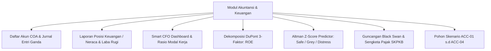
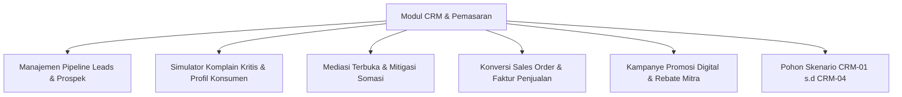
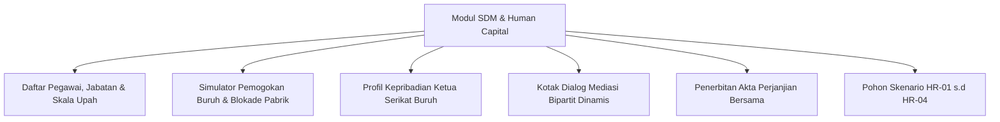
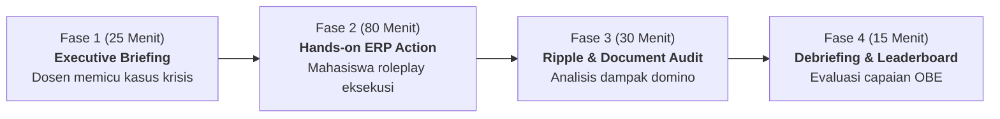
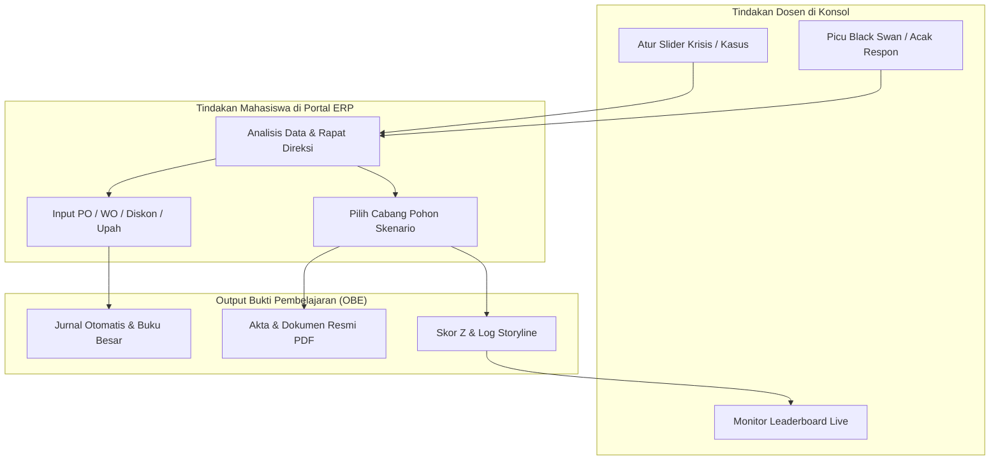
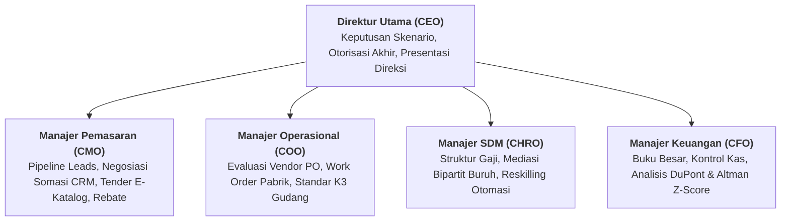
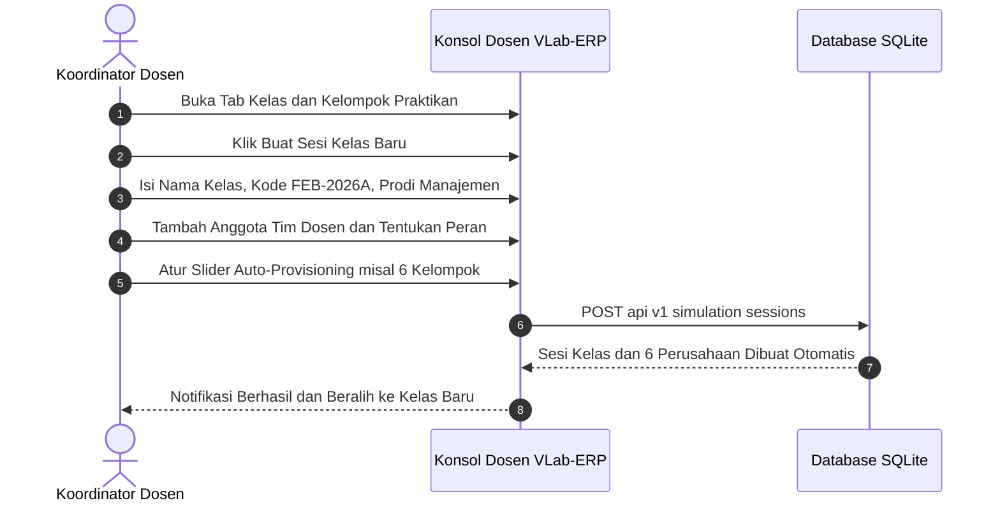
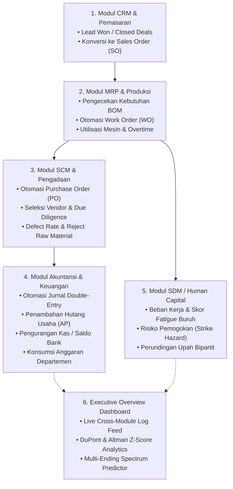

# BUNDLE DOKUMEN KURIKULUM & PANDUAN DOSEN VLAB-ERP

---
# FILE: PANDUAN_DOSEN_KEUANGAN_AKUNTANSI.md
---

# PANDUAN PRAKTIKUM & TUTORIAL DOSEN KEUANGAN & AKUNTANSI
## LABORATORIUM VLAB-ERP ENTERPRISE EDITION
## PROGRAM STUDI MANAJEMEN — UNIVERSITAS WIRA BHAKTI

---

### I. PERAN & FOKUS DOSEN KEUANGAN & AKUNTANSI
Sebagai Dosen Pengampu Bidang **Manajemen Keuangan & Akuntansi Bisnis Digital**, Anda bertanggung jawab memandu mahasiswa dalam:
1. Memahami pencatatan akuntansi entri ganda otomatis (*Automatic Double-Entry Ledger*) dan integrasi buku besar ke seluruh transaksi operasional (PO, WO, Payroll, SO).
2. Mengevaluasi posisi likuiditas, solvabilitas, dan kecukupan modal kerja (*Net Working Capital*).
3. Menganalisis kinerja profitabilitas menggunakan **Model Dekomposisi DuPont 3-Faktor**.
4. Mengukur risiko kebangkrutan perusahaan manufaktur melalui **Altman Z-Score Distress Predictor**.
5. Menghadapi guncangan tak terduga (*Black Swan Financial Shocks*), mitigasi sengketa Surat Ketetapan Pajak Kurang Bayar (SKPKB), dan restrukturisasi pinjaman perbankan (*Covenant Breach*).

---

### II. FITUR UTAMA MODUL KEUANGAN & AKUNTANSI DI VLAB-ERP

#### 2. Rantai Pembukuan Berpasangan Otomatis (*Double-Entry Accounting Automator*)
Sistem VLab-ERP secara otomatis menjurnal setiap transaksi operasional ke buku besar:
- **Transaksi PO (Beli Bahan Baku Tempo)**:
  - *Debit*: Persediaan Bahan Baku (Akun 1030)
  - *Kredit*: Utang Usaha / AP (Akun 2010)
  - *Dampak Anggaran*: Menambah realisasi belanja pada `DepartmentBudget` Pengadaan (*Procurement*).
- **Pelunasan Hutang Vendor (AP Quick Pay)**:
  - *Debit*: Utang Usaha / AP (Akun 2010)
  - *Kredit*: Kas & Bank (Akun 1010)
- **Transaksi SO (Penjualan Selesai/Won)**:
  - *Debit*: Piutang Usaha / AR (Akun 1020)
  - *Kredit*: Pendapatan Penjualan (Akun 4010)
- **Work Order & Maintenance**:
  - *Debit*: Biaya Operasional Produksi (Akun 5010)
  - *Kredit*: Kas / Utang Akrual
  - *Dampak Anggaran*: Menambah realisasi belanja pada `DepartmentBudget` Produksi.

---

### III. MODEL DIAGNOSTIK SMART CFO (DUPONT & ALTMAN Z-SCORE)

#### 1. Rasio Likuiditas & Modal Kerja
- **Current Ratio** $= \frac{\text{Aset Lancar}}{\text{Liabilitas Lancar}}$ (Standar Sehat: $> 1.5\text{x}$, Batas Kritis: $1.2\text{x}$).
- **Quick Ratio (Acid-Test)** $= \frac{\text{Kas} + \text{Piutang}}{\text{Liabilitas Lancar}}$ (Standar Sehat: $> 1.0\text{x}$).
- **Cash Ratio** $= \frac{\text{Kas}}{\text{Liabilitas Lancar}}$ (Standar Aman: $> 0.5\text{x}$).

#### 2. Dekomposisi DuPont 3-Faktor
Smart CFO memecah Return on Equity (ROE) menjadi tiga pendorong kinerja independen:
$$\text{ROE} = \underbrace{\left( \frac{\text{Net Income}}{\text{Revenue}} \right)}_{\text{Net Profit Margin}} \times \underbrace{\left( \frac{\text{Revenue}}{\text{Total Assets}} \right)}_{\text{Asset Turnover}} \times \underbrace{\left( \frac{\text{Total Assets}}{\text{Total Equity}} \right)}_{\text{Equity Multiplier}}$$
- **Net Profit Margin**: Mengukur efisiensi penetapan harga dan pengendalian beban operasional.
- **Asset Turnover**: Mengukur efisiensi pemanfaatan aset pabrik dalam menghasilkan omzet.
- **Equity Multiplier (Financial Leverage)**: Mengukur proporsi pendanaan aset yang dibiayai utang.

#### 3. Model Prediksi Kebangkrutan Altman Z-Score
Dihitung secara deterministik menggunakan model *Altman Z'-Score for Private Manufacturing*:
$$Z = 0.717(X_1) + 0.847(X_2) + 3.107(X_3) + 0.420(X_4) + 0.998(X_5)$$
- $X_1 = \frac{\text{Working Capital}}{\text{Total Assets}}$
- $X_2 = \frac{\text{Retained Earnings}}{\text{Total Assets}}$
- $X_3 = \frac{\text{EBIT}}{\text{Total Assets}}$
- $X_4 = \frac{\text{Book Value Equity}}{\text{Total Liabilities}}$
- $X_5 = \frac{\text{Sales}}{\text{Total Assets}}$

**Klasifikasi Zona Kesehatan Finansial**:
- 🟢 **SAFE ZONE** ($Z \ge 2.90$): Perusahaan sangat sehat, risiko gagal bayar mendekati 0%.
- 🟡 **GREY ZONE** ($1.23 \le Z < 2.90$): Perusahaan waspada, butuh perbaikan perputaran modal kerja.
- 🔴 **DISTRESS ZONE** ($Z < 1.23$): Bahaya kebangkrutan nyata, terancam likuidasi dalam 2 periode.

---

### IV. POHON KEPUTUSAN SKENARIO KEUANGAN (DOMAIN AKUNTANSI)

Dosen Keuangan mengampu **4 Skenario Strategis** pada tab **Pohon Keputusan Multi-Skenario**:

| Kode | Judul Skenario | Konteks Masalah | Pilihan Cabang & Dampak Domino |
| :--- | :--- | :--- | :--- |
| **ACC-01** | **Pemeriksaan Pajak Mendadak (SKPKB PPN)** | KPP menerbitkan SKPKB senilai Rp 25 Juta atas selisih faktur pajak masukan 2 tahun lalu dengan tempo bayar 14 hari. | • **Cabang A**: Bayar Lunas SKPKB Rp 25 Juta (Kas terpotong Rp 25 Juta, Buku pajak dinyatakan Clean & Clear, terbit *SSP No. 082*). • **Cabang B**: Sewa Konsultan Pajak Rp 8 Juta & Ajukan Keberatan (Hemat kas saat ini, proses sengketa 6-12 bulan). |
| **ACC-02** | **Pilihan Kebijakan Penyusutan Aset Tetap** | Pembelian mesin baru Rp 100 Juta memerlukan penetapan metode depresiasi akuntansi. | • **Cabang A**: Saldo Menurun Ganda (*Double Declining*) (Beban awal besar, hemat pajak riil via *Tax Shield*). • **Cabang B**: Garis Lurus (*Straight Line*) (Laba bersih stabil merata setiap periode). |
| **ACC-03** | **Peringatan Likuiditas Bank & Covenant Breach** | Bank mitra memperingatkan Current Ratio mendekati batas 1.2x. Terancam penalti bunga 3% dan pelunasan dipercepat. | • **Cabang A**: Restrukturisasi Utang Bank & Tambah Modal Ekuitas (Current ratio aman $> 1.8\text{x}$, terbit *Addendum Kredit Bank No. 093*). • **Cabang B**: Likuidasi Cepat Stok Lambat Diskon 40% (Inflow kas segar masuk, catat kerugian diskon di Laba Rugi). |
| **ACC-04** | **Keputusan Belanja Modal Ekspansi (Capex)** | Rencana pembelian lini otomatisasi perakitan senilai Rp 80 Juta dengan Payback Period 14 bulan. | • **Cabang A**: Danai 50% Kas Internal + 50% Leasing (Kapasitas naik 60%, terbit *Kontrak Leasing No. 018*). • **Cabang B**: Tunda investasi & Maksimalkan mesin saat ini (Kas aman, kapasitas tetap di batas maksimum). |

---

### V. PANDUAN PRAKTIKUM MINGGU KE-12 S.D MINGGU KE-14

#### Pertemuan 12: Audit Laporan Posisi Keuangan & Jurnal Buku Besar
1. **Aktivitas Dosen**: Bimbing mahasiswa membuka **Modul Akuntansi $\rightarrow$ Buku Besar & Neraca Saldo**.
2. **Tugas Mahasiswa**: Rekonsiliasi seluruh arus kas masuk dari penjualan dan arus kas keluar dari PO pengadaan bahan baku serta payroll pegawai.
3. **Analisis**: Hitung modal kerja bersih (*Net Working Capital*) kelompok: $\text{NWC} = \text{Aset Lancar} - \text{Liabilitas Lancar}$.

#### Pertemuan 13: Dekomposisi DuPont 3-Faktor di Smart CFO Dashboard
1. **Instruksi ke Mahasiswa**: Buka tab **Misi Hub $\rightarrow$ Sub-Tab Smart CFO: DuPont & Altman Z-Score**.
2. **Tugas Mahasiswa**: Analisis kartu interaktif 3 pendorong ROE kelompok.
3. **Studi Komparasi**: Bandingkan kelompok yang memiliki ROE tinggi karena *Asset Turnover* yang agresif vs kelompok yang memiliki ROE tinggi karena *Financial Leverage* (utang tinggi).

#### Pertemuan 14: Simulasi Prediksi Kebangkrutan & Audit Pajak SKPKB
1. **Aktivitas Dosen**: Klik tombol **"Guncangan Black Swan"** di portal untuk memicu audit pajak mendadak atau gagal bayar piutang klien.
2. **Tugas Mahasiswa**: Buka Skenario ACC-01 dan ACC-03. Mahasiswa harus mempertahankan skor Altman Z di atas $2.90$ (Safe Zone) setelah membayar kewajiban pajak dan melunasi denda perbankan.
3. **Output Praktikum**: Mahasiswa menerbitkan dan mengunduh dokumen **Surat Setoran Pajak (SSP) Pelunasan SKPKB No. 082/SSP-KPP/2026**.

---

### VI. RUBRIK PENILAIAN PRAKTIKUM DOSEN KEUANGAN & AKUNTANSI

| Kriteria Penilaian | Indikator Ketercapaian | Bobot |
| :--- | :--- | :---: |
| **Kesehatan Rasio Likuiditas & Modal Kerja** | Current Ratio $\ge 1.5\text{x}$, Cash Ratio $\ge 0.5\text{x}$, Net Working Capital positif. | 30% |
| **Optimasi Model DuPont (ROE)** | Nilai ROE $\ge 15\%$ didorong oleh Net Profit Margin yang sehat dan perputaran aset optimal. | 25% |
| **Ketahanan Solvabilitas & Altman Z-Score** | Mempertahankan skor Z pada **Safe Zone ($Z \ge 2.90$)** sepanjang periode simulasi. | 25% |
| **Penyelesaian Kasus Pajak & Bank** | Eksekusi tepat pada skenario ACC-01 s.d ACC-04 dan kepatuhan penyetoran pajak negara. | 20% |
| **TOTAL** | | **100%** |

---
# FILE: PANDUAN_DOSEN_PEMASARAN_CRM.md
---

# PANDUAN PRAKTIKUM & TUTORIAL DOSEN PEMASARAN & CRM
## LABORATORIUM VLAB-ERP ENTERPRISE EDITION
## PROGRAM STUDI MANAJEMEN — UNIVERSITAS WIRA BHAKTI

---

### I. PERAN & FOKUS DOSEN PEMASARAN
Sebagai Dosen Pengampu Bidang **Manajemen Pemasaran & CRM**, Anda bertanggung jawab membimbing mahasiswa dalam memahami:
1. Pengelolaan prospek penjualan (*Leads*) dan konversi menjadi pesanan penjualan resmi (*Sales Order*).
2. Penanganan komplain pelanggan kritis (*Crisis CRM*) berbasis profil emosional konsumen (*Customer Temperaments*).
3. Negosiasi komersial B2B, penawaran tender pemerintah (*E-Katalog B2G*), kebijakan batas kredit (*Term of Payment*), dan program loyalitas agen (*Year-End Rebate*).
4. Penyelamatan kontrak jangka panjang dan perlindungan reputasi pasar korporasi.

---

### II. FITUR UTAMA MODUL PEMASARAN & CRM DI VLAB-ERP

#### 1. Manajemen Pipeline Prospek & Keluhan Pelanggan
- Akses melalui Menu Navigasi: **Portal ERP Mahasiswa $\rightarrow$ Modul CRM & Pelanggan** atau **Konsol Dosen $\rightarrow$ Kasus & Skenario**.
- Mahasiswa dapat memantau status prospek: `Baru (New)`, `Proposisi Nilai (Proposition)`, `Negosiasi (Negotiation)`, `Selesai (Won/Resolved)`, atau `Batal (Lost)`.

#### 2. Generator Karakter Emosional Pelanggan (*Customer Temperament Engine*)
Pelanggan di VLab-ERP memiliki 4 kepribadian realistis non-deterministik:
- **Akun Korporat Eskalasi Kritis (Merah)**: Bertoleransi rendah (15%), menuntut kompensasi minimal 15% atau melayangkan somasi hukum dan viral media sosial.
- **Mitra Bisnis Jangka Panjang (Hijau)**: Sangat kooperatif (toleransi 75%), mengutamakan penggantian unit berkualitas tinggi dengan tuntutan diskon minim (5%).
- **Klien Institusi Strategis (Ungu)**: Pasif-agresif (toleransi 40%), menuntut diskon kompensasi 10% dan respons cepat sebelum melapor ke asosiasi industri.
- **Distributor Utama Regional (Biru)**: Kalkulatif dan cerdas bernegosiasi (toleransi 50%), meminta kompensasi unit ekstra dan perpanjangan tempo pembayaran.

> **💡 Tips Dosen**: Gunakan tombol **"Acak Respon Pelanggan"** pada kartu keluhan untuk mengubah secara dinamis profil emosi dan narasi komplain pelanggan, menguji ketangguhan mahasiswa dalam menghadapi tipe konsumen yang berbeda-beda!

#### 4. Rantai Otomasi Transaksi (Sales Order ➔ MRP ➔ SCM ➔ Akuntansi)
Ketika deal penjualan di CRM berstatus **Won / Selesai**, sistem VLab-ERP secara cerdas mengeksekusi integrasi otomatis (*The Ripple Engine*):
1. **Pengecekan Stok Barang Jadi**: Sistem memeriksa apakah stok barang jadi di gudang mencukupi.
2. **Otomasi Work Order (WO)**: Jika stok kurang, sistem otomatis menerbitkan *Perintah Kerja Produksi (WO)* sesuai kebutuhan BOM.
3. **Otomasi Purchase Order (PO)**: Jika bahan baku mentah (IC Microcontroller, PCB, Display) tidak cukup di gudang, sistem langsung menerbitkan *Pesanan Pembelian (PO)* ke vendor rekanan.
4. **Otomasi Jurnal Akuntansi**: Menambah Piutang Usaha (AR Akun 1020), Pendapatan Penjualan (Akun 4010), dan memotong plafon anggaran operasional terkait.
5. **Pencatatan Audit Trail**: Seluruh pergerakan transaksi tercatat pada *Executive Live Log Feed* di dashboard utama.

---

### III. POHON KEPUTUSAN SKENARIO PEMASARAN (DOMAIN CRM)

Dosen Pemasaran mengampu **4 Skenario Strategis** pada tab **Pohon Keputusan Multi-Skenario**:

| Kode | Judul Skenario | Konteks Masalah | Pilihan Cabang & Dampak Domino |
| :--- | :--- | :--- | :--- |
| **CRM-01** | **Ancaman Somasi Hukum Klien Utama (PT Megatama)** | 35 unit mesin terlambat 10 hari dan salah kalibrasi. Klien menuntut ganti rugi Rp 50 Juta atau perkara dibawa ke Pengadilan Niaga. | • **Cabang A**: Diskon 15% + Teknisi Onsite (Biaya Rp 22 Juta, Somasi dicabut, terbit *Akta Perdamaian Bipartit*). • **Cabang B**: Lawan somasi via kuasa hukum (*Force Majeure*) (Biaya Rp 15 Juta, Hubungan putus, Piutang Rp 35 Juta macet). • **Cabang C**: Ganti unit baru utuh 100% (Biaya HPP Rp 18 Juta, Nilai invoice utuh tertagih). |
| **CRM-02** | **Peluang Tender Pemerintah (E-Katalog B2G)** | Tender lab Kemendikbudristek Rp 300 Juta mensyaratkan Bank Guarantee dan sertifikasi TKDN minimal 40%. | • **Cabang A**: Ikut tender penuh mandiri (Biaya jaminan bank Rp 25 Juta, Margin profit 100% milik sendiri). • **Cabang B**: Kemitraan Konsorsium KSO dengan distributor lokal (Biaya Rp 5 Juta, Berbagi margin 30% dengan mitra). |
| **CRM-03** | **Distributor Minta Perpanjangan TOP 90 Hari** | Distributor penyerap 45% penjualan meminta perpanjangan tempo pembayaran dari 30 hari ke 90 hari. | • **Cabang A**: Tolak dan pertahankan TOP 30 hari (Arus kas aman, DSO rendah, distributor pangkas kuota 30%). • **Cabang B**: Setujui TOP 90 hari dengan jaminan Bilyet Giro Mundur & bunga 2% (Penjualan maksimal, terbit *Addendum Kredit*). |
| **CRM-04** | **Program Insentif Rebate Tahunan Mitra** | Asosiasi reseller menuntut skema cashback akhir tahun untuk mendongkrak penjualan produk VLab. | • **Cabang A**: Skema Rebate Berjenjang 5% (Biaya insentif Rp 15 Juta, Volume penjualan melonjak 28%). • **Cabang B**: Tolak rebate kas, fokus iklan medsos (Biaya iklan Rp 5 Juta, Brand awareness naik, reseller datar). |

---

### IV. PANDUAN PRAKTIKUM MINGGU KE-4 S.D MINGGU KE-7

#### Pertemuan 4: Analisis Perilaku Konsumen & Manajemen Komplain
1. **Instruksi ke Mahasiswa**: Buka Modul CRM, temukan data pelanggan dengan tiket keluhan aktif (*is_complaint = true*).
2. **Aktivitas Dosen**: Buka Konsol Dosen, klik **"Acak Respon Pelanggan"** pada kelompok tertentu untuk menghadirkan komplain kritis mendadak.
3. **Tugas Mahasiswa**: Buka modal mediasi, telaah tingkat toleransi konsumen, pilih opsi kompensasi yang adil, dan periksa apakah status tiket berubah menjadi `Resolved` dengan CSAT $> 85\%$.

#### Pertemuan 5: Simulasi Tender Pemerintah (E-Katalog B2G)
1. **Aktivitas Dosen**: Jelaskan konsep jaminan bank pelaksanaan (*Performance Bond*) dan sertifikasi TKDN.
2. **Instruksi ke Mahasiswa**: Buka tab **Pohon Keputusan Multi-Skenario $\rightarrow$ Filter CRM $\rightarrow$ Skenario CRM-02**.
3. **Diskusi Kelompok**: Menganalisis kondisi kas kelompok saat ini. Jika kas likuid melimpah ($> \text{Rp 200 Juta}$), pilih Cabang A; jika kas terbatas, pilih kemitraan KSO (Cabang B).

#### Pertemuan 6: Pengelolaan Batas Kredit & Siklus Piutang (DSO)
1. **Aktivitas Dosen**: Buka slider simulasi di Konsol Dosen, naikkan risiko *Market Volatility* ke $40\%$.
2. **Instruksi ke Mahasiswa**: Selesaikan kasus Skenario CRM-03. Mahasiswa harus menghitung implikasi penambahan piutang pada rasio likuiditas (*Current Ratio*) di modul Akuntansi.

#### Pertemuan 7: Kampanye Pemasaran Digital & Program Rebate
1. **Instruksi ke Mahasiswa**: Buka modul CRM $\rightarrow$ Sub-fitur Kampanye Pemasaran.
2. **Tugas Mahasiswa**: Tentukan alokasi anggaran kampanye iklan media sosial (Rp 10–30 Juta) dan eksekusi skenario CRM-04 Cabang A untuk mendongkrak penjualan sebelum tutup buku periode berjalan.

---

### V. RUBRIK PENILAIAN PRAKTIKUM DOSEN PEMASARAN

| Kriteria Penilaian | Indikator Ketercapaian | Bobot |
| :--- | :--- | :---: |
| **Kecepatan & Ketepatan Mitigasi Komplain** | Tiket komplain diselesaikan dalam 1 periode, somasi hukum dicabut resmi, CSAT $> 85\%$. | 30% |
| **Efektivitas Konversi Leads ke Sales Order** | Rasio konversi prospek ke pesanan penjualan $> 70\%$ dengan margin laba kotor $> 25\%$. | 25% |
| **Pengambilan Keputusan Skenario CRM** | Pemilihan cabang rasional pada skenario CRM-01 s.d CRM-04 dengan portofolio dokumen resmi lengkap. | 25% |
| **Manajemen Kebijakan Kredit & Piutang** | Nilai Days Sales Outstanding (DSO) terkendali di bawah 45 hari tanpa memicu piutang tak tertagih (*Bad Debt*). | 20% |
| **TOTAL** | | **100%** |

---
# FILE: PANDUAN_DOSEN_SDM_BIPARTIT.md
---

# PANDUAN PRAKTIKUM & TUTORIAL DOSEN SDM & HUBUNGAN INDUSTRIAL
## LABORATORIUM VLAB-ERP ENTERPRISE EDITION
## PROGRAM STUDI MANAJEMEN — UNIVERSITAS WIRA BHAKTI

---

### I. PERAN & FOKUS DOSEN SDM & HUBUNGAN INDUSTRIAL
Sebagai Dosen Pengampu Bidang **Manajemen SDM & Organisasi**, Anda bertanggung jawab memandu mahasiswa dalam:
1. Mengelola struktur kompensasi, perencanaan headcount tenaga kerja, dan alokasi shift produksi.
2. Menghadapi krisis pemogokan buruh massal (*Labor Strike Engine*) dan menyelenggarakan perundingan Bipartit yang humanis.
3. Memahami karakteristik profil pimpinan serikat buruh (*Union Leader Personalities*).
4. Menyusun dokumen hukum ketenagakerjaan resmi (*Akta Perjanjian Bersama Bipartit, Perjanjian Retensi Karyawan Kunci, Dokumen K3*).
5. Mengintegrasikan kebijakan SDM dengan produktivitas lini perakitan pabrik tanpa merusak struktur biaya tetap perusahaan (*Fixed Labor Overhead*).

---

### II. FITUR UTAMA MODUL SDM & BIPARTIT DI VLAB-ERP

#### 1. Manajemen Struktur Tenaga Kerja (*Employee Roster*)
- Akses melalui Menu Navigasi: **Portal ERP Mahasiswa $\rightarrow$ Modul SDM & Pegawai**.
- Menampilkan data karyawan lengkap dengan NIK, Departemen (Produksi, QC, Gudang, Engineering, Administrasi), Gaji Pokok, Tunjangan, Status Kepegawaian, dan Indeks Kinerja/Moral.

#### 2. Profil Pemimpin Serikat Buruh (*Union Personality Engine*)
VLab-ERP menghadirkan 3 arketipe pemimpin serikat pekerja yang realistis:
1. **Bambang Sukirman — Ketua Dewan Pengurus SP-Mandiri (Bebal & Militan)**:
   - *Karakter*: Garang, tidak mudah berkompromi, toleransi sangat rendah.
   - *Syarat Damai*: Kenaikan upah minimal $\ge 12\%$ dan bonus saku tunai $\ge \text{Rp 1.500.000}$ per orang.
   - *Respon Penolakan*: "Tawaran penghinaan macam apa ini?! Direksi makan enak buruh disuruh puasa! Negosiasi DITOLAK! Kami perpanjang mogok kerja!"
2. **Agus Prasetyo — Koordinator Forum Komunikasi Pekerja Pabrik (Manut & Kooperatif)**:
   - *Karakter*: Sangat memahami kondisi kas perusahaan, toleransi tinggi.
   - *Syarat Damai*: Kenaikan upah $\ge 5\%$ dan bonus saku $\ge \text{Rp 500.000}$ per orang.
   - *Respon Penerimaan*: "Terima kasih atas kebijaksanaan manajemen! Seluruh pekerja siap lembur malam ini mengejar target pesanan!"
3. **Hendra Wijaya — Ketua Presidium Aliansi Buruh Bersatu (Skeptikal & Pragmatis)**:
   - *Karakter*: Berorientasi bukti hitam di atas putih dan kepastian pencairan kas langsung.
   - *Syarat Damai*: Kenaikan upah $\ge 8\%$ dan uang saku tunai $\ge \text{Rp 1.000.000}$ per orang.

---

### III. POHON KEPUTUSAN SKENARIO SDM (DOMAIN HR)

Dosen SDM mengampu **4 Skenario Strategis** pada tab **Pohon Keputusan Multi-Skenario**:

| Kode | Judul Skenario | Konteks Masalah | Pilihan Cabang & Dampak Domino |
| :--- | :--- | :--- | :--- |
| **HR-01** | **Mogok Kerja Massal Serikat Buruh (Tuntutan Upah & Bonus)** | 40 pekerja memblokir gerbang pabrik menuntut kenaikan upah 12% dan uang saku damai Rp 1.5 Juta/orang. Lini produksi terhenti. | • **Cabang A**: Kesepakatan Bipartit (Upah naik 7% + Bonus Rp 24 Juta, Pabrik buka 100%, terbit *Perjanjian Bipartit No. 008*). • **Cabang B**: Tolak & Rekrut Outsourcing (Biaya Rp 16 Juta, Sengketa ke PHI, Defect rate naik 15%). • **Cabang C**: Uang saku tunai sekali bayar Rp 12 Juta tanpa naikkan upah pokok (Hemat fixed cost jangka panjang, tensi mereda). |
| **HR-02** | **Pembajakan (Poaching) Kepala Engineer Litbang** | Lead Engineer dan teknisi kunci ditawari kenaikan gaji 40% oleh kompetitor multinasional. | • **Cabang A**: Counter-Offer: Naik gaji 25% + Bonus Retensi (Biaya Rp 15 Juta, Tim R&D bertahan, terbit *Retention Agreement*). • **Cabang B**: Lepas karyawan & Tuntut Non-Compete Agreement (Hemat kas, namun inovasi produk baru tertunda 3 bulan). |
| **HR-03** | **Otomasi Robotik & Reskilling 10 Pekerja Packing** | Otomasi mesin perakitan menggantikan 10 posisi manual. Perusahaan harus menentukan nasib 10 pekerja. | • **Cabang A**: Pelatihan Reskilling menjadi Operator QC Robotik (Biaya modul Rp 14 Juta, Zero Layoff, Kapasitas lini naik 40%). • **Cabang B**: Pensiun Dini Sukarela (Golden Shakehand) (Biaya pesangon Rp 35 Juta, Struktur headcount berkurang permanen). |
| **HR-04** | **Kecelakaan Kerja di Pergudangan (Forklift Incident)** | Forklift rem blong menabrak rak, melukai staf gudang dan merusak persediaan senilai Rp 8 Juta. | • **Cabang A**: Tanggung Pengobatan VIP, Santunan & Audit Gudang (Biaya Rp 12 Juta, Kepercayaan buruh tinggi, terbit *Laporan K3*). • **Cabang B**: Klaim standar BPJS Ketenagakerjaan saja (Biaya Rp 2 Juta, Buruh mempertanyakan kepedulian moral manajemen). |

---

### IV. PANDUAN PRAKTIKUM MINGGU KE-9 S.D MINGGU KE-11

#### Pertemuan 9: Pemicu Pemogokan Buruh & Analisis Kerugian Downtime
1. **Aktivitas Dosen**: Buka **Konsol Dosen $\rightarrow$ Slider Simulasi $\rightarrow$ Naikkan Risiko *Labor Strike Risk* ke $80\%$**.
2. **Pengamatan Mahasiswa**: Mahasiswa akan melihat banner merah krisis pemogokan buruh di dashboard, status `is_strike_active = true`, dan lini produksi manufaktur terkunci (*bottleneck zero output*).
3. **Analisis Mahasiswa**: Hitung potensi kerugian harian pabrik (Rp 15 Juta/hari) vs biaya kompensasi tuntutan serikat pekerja.

#### Pertemuan 10: Perundingan Bipartit Humanis & Penerbitan Dokumen Resmi
1. **Instruksi ke Mahasiswa**: Buka modul SDM $\rightarrow$ Sub-fitur Mediasi Bipartit.
2. **Simulasi Tawar-Menawar**: Mahasiswa memasukkan persentase kenaikan upah (misal: 7%) dan nominal bonus saku (misal: Rp 1.000.000).
3. **Hasil Mediasi**: Jika tawaran memenuhi batas toleransi ketua serikat, pemogokan dicabut seketika, moral pekerja pulih ke $95\%$, dan sistem menerbitkan **Akta Perjanjian Bersama Bipartit No. 008/BIP-DISNAKER/2026**.
4. **Verifikasi Dosen**: Periksa apakah kelompok telah mengunduh dokumen resmi tersebut dan memverifikasi pencatatan beban gaji di modul Akuntansi.

#### Pertemuan 11: Manajemen Talenta, K3 & Keputusan Etis Reskilling
1. **Instruksi ke Mahasiswa**: Buka tab **Pohon Keputusan Multi-Skenario $\rightarrow$ Filter SDM $\rightarrow$ Selesaikan Skenario HR-02, HR-03, dan HR-04**.
2. **Debat Kelas**: Diskusikan nilai humanis Universitas Wira Bhakti: mengapa opsi *Reskilling Karyawan* (Cabang A pada HR-03) lebih mencerminkan kepemimpinan beretika dibanding pemecatan massal (*Layoff*).

---

### V. RUBRIK PENILAIAN PRAKTIKUM DOSEN SDM

| Kriteria Penilaian | Indikator Ketercapaian | Bobot |
| :--- | :--- | :---: |
| **Keberhasilan Mediasi Bipartit** | Pemogokan buruh selesai dalam $\le 2$ putaran negosiasi, moral kerja $\ge 90\%$, lini produksi beroperasi normal. | 35% |
| **Keseimbangan Biaya Tenaga Kerja** | Kenaikan beban upah bulanan tidak melebihi kapasitas laba operasional kelompok ($< 10\%$). | 25% |
| **Penyelesaian Skenario Kasus Ketenagakerjaan** | Eksekusi tepat pada skenario HR-01 s.d HR-04 disertai penerbitan dokumen hukum resmi. | 25% |
| **Penerapan Prinsip Etika & Humanisme** | Pemilihan solusi yang menjunjung tinggi keselamatan kerja (K3) dan pengembangan kapasitas manusia (*Reskilling*). | 15% |
| **TOTAL** | | **100%** |

---
# FILE: PANDUAN_INTEGRASI_VLAB_DALAM_PEMBELAJARAN.md
---

# PEDOMAN INTEGRASI OPERASIONAL VLAB-ERP DALAM PROSES BELAJAR MENGAJAR
## LABORATORIUM SIMULASI BISNIS DIGITAL & ERP TERINTEGRASI
## PROGRAM STUDI MANAJEMEN — UNIVERSITAS WIRA BHAKTI

---

### I. METODOLOGI PEMBELAJARAN: SIKLUS 150 MENIT PER PERTEMUAN (3 SKS)

Setiap sesi perkuliahan 3 SKS (150 menit) di Laboratorium Komputer / Bisnis Digital FEB Universitas Wira Bhakti dijalankan dengan struktur terstandar berbasis **Problem-Based Learning (PBL)** dan **Active Gamified Simulation**:

| Alokasi Waktu | Tahapan Aktivitas | Peran Dosen Pengampu | Aktivitas Mahasiswa (Kelompok Praktikan) | Modul VLab-ERP Terlibat |
| :--- | :--- | :--- | :--- | :--- |
| **00 – 25 Menit** | **1. Executive Briefing & Triggering Krisis** | • Menjelaskan teori manajerial singkat (15 menit). • Mengatur slider krisis di Konsol Dosen (misal: *Supply Disruption* 50%, *Labor Strike* 70%, atau mengacak komplain pelanggan). | • Menyimak arahan dosen. • Login ke Portal ERP Mahasiswa menggunakan akun kelompok masing-masing. • Meninjau kondisi awal kas (Rp 500 Juta) dan dashboard eksekutif. | Konsol Dosen (Slider Krisis) & Dashboard Portal Mahasiswa |
| **25 – 105 Menit** | **2. Active Hands-On Simulation & Problem Solving** | • Mengamati dinamika kelompok secara live. • Berkeliling memfasilitasi diskusi strategis mahasiswa. • Memantau log transaksi yang masuk ke backend secara real-time. | • **Direktur Utama (CEO)**: Memimpin rapat direksi kelompok. • **Manajer Pengadaan**: Menghitung HPP, memilih vendor, menerbitkan Purchase Order (PO). • **Manajer Pabrik**: Menjalankan Work Order (WO) perakitan barang jadi. • **Manajer Pemasaran**: Menangani komplain, negosiasi somasi, tender e-katalog. • **Manajer SDM**: Mediasi Bipartit serikat buruh. • **Manajer Keuangan**: Memantau arus kas dan buku besar. | Modul Purchasing, MRP Pabrik, CRM Pelanggan, SDM Pegawai, dan Akuntansi |
| **105 – 135 Menit**| **3. Domino Ripple Observation & Legal Verification** | • Membimbing mahasiswa menelaah hubungan sebab-akibat lintas fungsi. • Menginstruksikan mahasiswa mengunduh dokumen legal yang diterbitkan sistem. | • Membuka notifikasi pop-up **Domino Ripple Effect**. • Memeriksa dampak keputusan ke departemen lain (misal: Diskon CRM $\rightarrow$ Beban Laba Rugi Finance). • Membuka dan mencetak **Dokumen Resmi Bisnis** (*Addendum Kontrak, Akta Bipartit, SSP Pajak*). • Menganalisis kartu **Smart CFO: DuPont & Altman Z-Score**. | Tab Misi Hub, Modal Dokumen Resmi, dan Smart CFO Dashboard |
| **135 – 150 Menit**| **4. Cross-Team Debriefing & Live Leaderboard** | • Menampilkan **Live Leaderboard & Competency Radar** di layar proyektor kelas. • Membedah kelompok dengan kinerja terbaik (*Best Practice*) vs kelompok dalam zona bahaya (*Distress Zone*). • Memberikan umpan balik konstruktif dan refleksi OBE. | • Membandingkan peringkat valuasi dan skor CSAT/Moral kelompoknya terhadap kompetitor kelas. • Mencatat evaluasi untuk perbaikan periode simulasi berikutnya. | Konsol Dosen (Leaderboard & Radar Kompetensi) |

---

### II. MATRIKS INTEGRASI OPERASIONAL MINGGUAN (AKTIVITAS DOSEN VS MAHASISWA)

Berikut adalah panduan teknis langkah-demi-langkah pengoperasian VLab-ERP untuk setiap minggu perkuliahan:

#### Minggu 1: Setup Korporasi, Pembagian Peran & Navigasi ERP
- **Dosen**: Buka Konsol Dosen $\rightarrow$ Buat Sesi Kelas Baru $\rightarrow$ Tambah Tim Dosen $\rightarrow$ Auto-Provisioning 4–6 Kelompok @ Rp 500 Juta.
- **Mahasiswa**: Login dengan user `mahasiswa` / pass `mhs123` $\rightarrow$ Bagi peran direksi (CEO, CFO, CMO, HRD, COO) $\rightarrow$ Tinjau neraca awal kas Rp 500.000.000.
- **Bukti Belajar**: Struktur organisasi kelompok terbentuk dan terdaftar di database.

#### Minggu 2: Perencanaan Kebutuhan Bahan Baku (MRP) & Pengadaan (PO)
- **Dosen**: Di Konsol Dosen, geser slider *Supply Disruption* ke 30% untuk menyimulasikan kelangkaan komponen.
- **Mahasiswa**: Buka **Modul Purchasing** $\rightarrow$ Bandingkan 3 vendor (lead time vs defect rate vs harga) $\rightarrow$ Terbitkan PO Motherboard, Casing, dan Pasif $\rightarrow$ Verifikasi kas keluar di modul Akuntansi.
- **Bukti Belajar**: Dokumen PO resmi tersimpan, mutasi akun `1010 Kas` berkurang dan `1030 Persediaan Bahan Baku` bertambah.

#### Minggu 3: Perintah Kerja Perakitan (Work Order) & Manajemen Work Centers
- **Dosen**: Geser slider *Machine Breakdown Risk* ke 20% untuk menyimulasikan potensi malfungsi mesin perakitan.
- **Mahasiswa**: Buka **Modul Manufaktur (MRP)** $\rightarrow$ Input kuantitas Work Order (misal: 30 unit) $\rightarrow$ Alokasikan ke Work Center SMT $\rightarrow$ Pantau waktu siklus perakitan.
- **Bukti Belajar**: Jurnal mutasi persediaan Bahan Baku (WIP) ke Barang Jadi (FG) terbentuk otomatis di Buku Besar.

#### Minggu 4: Analisis Temperamen Konsumen & Mitigasi Somasi CRM
- **Dosen**: Buka Konsol Dosen $\rightarrow$ Klik tombol **"Acak Respon Pelanggan"** pada tiket komplain PT Megatama untuk memunculkan karakter pemarah (*Annoyingly Angry*).
- **Mahasiswa**: Buka **Modul CRM** $\rightarrow$ Baca narasi ancaman somasi $\rightarrow$ Buka modal mediasi $\rightarrow$ Tawarkan diskon kompensasi 15% + kunjungan teknisi onsite $\rightarrow$ Status berubah menjadi `Resolved` dan skor CSAT naik ke $> 88\%$.
- **Bukti Belajar**: Tiket CRM teresolusi, Credit Note terbit memotong saldo piutang.

#### Minggu 5: Tender Pengadaan Pemerintah (E-Katalog B2G)
- **Dosen**: Instruksikan mahasiswa membuka skenario **CRM-02** pada tab Pohon Keputusan.
- **Mahasiswa**: Buka **Misi Hub $\rightarrow$ Pohon Keputusan Multi-Skenario $\rightarrow$ CRM-02** $\rightarrow$ Analisis kecukupan kas jaminan bank garansi (Cabang A) vs Kemitraan Konsorsium KSO (Cabang B) $\rightarrow$ Eksekusi cabang terpilih.
- **Bukti Belajar**: Log peristiwa story event tercatat, dokumen *Pakta Integritas Tender E-Katalog* diterbitkan.

#### Minggu 6: Pengelolaan Kebijakan Kredit & Tenor Pembayaran (TOP 90 Hari)
- **Dosen**: Geser slider *Bad Debt Risk* ke 25% di Konsol Dosen.
- **Mahasiswa**: Buka **Skenario CRM-03** $\rightarrow$ Evaluasi permohonan TOP 90 hari distributor $\rightarrow$ Pilih opsi syarat penyerahan Bilyet Giro Mundur & biaya bunga 2% $\rightarrow$ Pantau rasio Days Sales Outstanding (DSO) di modul Akuntansi.
- **Bukti Belajar**: Dokumen *Addendum Perjanjian Fasilitas Kredit No. 062* terbit.

#### Minggu 7: Kampanye Pemasaran Digital & Program Rebate Reseller
- **Dosen**: Tinjau perolehan omzet seluruh kelompok di Leaderboard.
- **Mahasiswa**: Buka **Modul CRM $\rightarrow$ Kampanye Marketing** $\rightarrow$ Alokasikan budget promosi Rp 20 Juta $\rightarrow$ Buka **Skenario CRM-04** dan aktifkan program Year-End Rebate 5% $\rightarrow$ Amati lonjakan konversi Leads menjadi Sales Order.
- **Bukti Belajar**: Sales Order baru terkonversi, laporan omzet kuartalan meningkat 28%.

#### Minggu 8: Evaluasi Tengah Semester (UTS - Ujian Kasus Lapangan)
- **Tim Dosen**: Memberikan skenario krisis gabungan (Vendor gagal kirim + Komplain kritis serentak) $\rightarrow$ Menguji kemampuan reaksi kelompok dalam 60 menit.
- **Mahasiswa**: Mengeksekusi instruksi operasional di modul terkait $\rightarrow$ Mengklik **"Validasi & Selesaikan Kasus"** $\rightarrow$ Menerima penilaian otomatis sistem (0–100 pts) dan grading grade A/B/C.
- **Bukti Belajar**: Nilai UTS otomatis terekam di sistem dan matriks ketercapaian langkah (*Step Scores*) tersimpan.

#### Minggu 9: Penanganan Pemogokan Buruh Pabrik (Labor Strike)
- **Dosen**: Buka Konsol Dosen $\rightarrow$ Naikkan slider *Labor Strike Risk* ke 80% $\rightarrow$ Banner krisis mogok aktif di portal mahasiswa.
- **Mahasiswa**: Buka **Modul SDM** $\rightarrow$ Telaah profil Ketua Serikat Buruh (Bambang Sukirman / Agus Prasetyo / Hendra Wijaya) $\rightarrow$ Amati lini perakitan manufaktur yang terkunci $\rightarrow$ Hitung batas toleransi kas untuk kenaikan upah.
- **Bukti Belajar**: Log status pemogokan buruh dan analisis kerugian downtime harian.

#### Minggu 10: Perundingan Bipartit Humanis & Penerbitan Dokumen Resmi
- **Dosen**: Mengamati jalannya mediasi Bipartit di kelas.
- **Mahasiswa**: Buka kotak mediasi Bipartit $\rightarrow$ Tawarkan kenaikan upah 7% + bonus uang saku damai Rp 1.000.000 $\rightarrow$ Serikat buruh menerima kesepakatan $\rightarrow$ Blokade mesin terbuka seketika dan moral pekerja naik ke 95%.
- **Mahasiswa**: Buka notifikasi ripple $\rightarrow$ Klik **"Lihat Dokumen Resmi Diterbitkan"** $\rightarrow$ Unduh **Akta Perjanjian Bersama Bipartit No. 008/BIP-DISNAKER/2026**.
- **Bukti Belajar**: Akta Perjanjian Bersama Bipartit berstempel legal digital tersimpan di log dokumen kelompok.

#### Minggu 11: Keselamatan Kerja (K3), Retensi Talenta & Alih Keterampilan
- **Dosen**: Memicu insiden kecelakaan kerja atau penawaran pembajakan talenta.
- **Mahasiswa**: Eksekusi **Skenario HR-02** (Counter-offer retensi insinyur) dan **Skenario HR-03** (Reskilling 10 pekerja packing menjadi operator robotik tanpa PHK).
- **Bukti Belajar**: Dokumen *Retention Agreement No. 051* dan *SK Program Alih Kompetensi No. 035* terbit.

#### Minggu 12: Audit Laporan Keuangan Neraca, Laba Rugi & Modal Kerja
- **Dosen**: Buka Modul Akuntansi bersama mahasiswa di proyektor.
- **Mahasiswa**: Buka **Modul Akuntansi $\rightarrow$ Neraca Saldo & Laba Rugi** $\rightarrow$ Rekonsiliasi seluruh jurnal transaksi $\rightarrow$ Hitung Net Working Capital: $\text{NWC} = \text{Aset Lancar} - \text{Liabilitas Lancar}$.
- **Bukti Belajar**: Laporan keuangan audited periode berjalan tervalidasi imbang (*balanced*).

#### Minggu 13: Dekomposisi DuPont 3-Faktor di Smart CFO Dashboard
- **Dosen**: Menjelaskan korelasi antara Margin Laba, Perputaran Aset, dan Leverage Keuangan terhadap ROE.
- **Mahasiswa**: Buka **Misi Hub $\rightarrow$ Sub-Tab Smart CFO: DuPont & Altman Z-Score** $\rightarrow$ Analisis kartu interaktif 3 faktor pengali ROE $\rightarrow$ Rumuskan rekomendasi perbaikan efisiensi aset.
- **Bukti Belajar**: Tangkapan layar analisis dekomposisi DuPont dan formulasi target ROE $> 15\%$.

#### Minggu 14: Prediksi Kebangkrutan Altman Z-Score & Sengketa Pajak SKPKB
- **Dosen**: Klik tombol **"Guncangan Black Swan"** di portal untuk menerbitkan SKPKB Pajak Rp 25 Juta atau gagal bayar piutang.
- **Mahasiswa**: Buka **Skenario ACC-01** $\rightarrow$ Bayar lunas SKPKB Rp 25 Juta $\rightarrow$ Buka **Skenario ACC-03** untuk restrukturisasi pinjaman bank agar Current Ratio tetap $> 1.5\text{x}$ $\rightarrow$ Pantau posisi gauge Altman Z tetap berada di **Safe Zone ($Z \ge 2.90$)**.
- **Bukti Belajar**: Dokumen *Surat Setoran Pajak (SSP) No. 082* dan *Addendum Kredit Bank No. 093* tersimpan.

#### Minggu 15: Open Sandbox Integrasi 20 Skenario Bebas
- **Tim Dosen**: Membuka seluruh domain skenario $\rightarrow$ Mengizinkan kelompok mengambil keputusan strategis bebas untuk memaksimalkan valuasi perusahaan.
- **Mahasiswa**: Menyelesaikan skenario tersisa pada domain Purchasing, Manufacturing, CRM, HR, dan Accounting $\rightarrow$ Memantau efek domino multi-level pada arus kas dan reputasi pasar.
- **Bukti Belajar**: Log kronologi lengkap (*Storyline*) berisi seluruh riwayat keputusan dan portofolio dokumen hukum korporasi.

#### Minggu 16: Evaluasi Akhir Semester (UAS - Grand Enterprise Showcase)
- **Tim Dosen**: Duduk sebagai Dewan Komisaris / Investor Panelis $\rightarrow$ Menilai presentasi pertanggungjawaban direksi tiap kelompok.
- **Mahasiswa**: Mempresentasikan:
  1. Kinerja Finansial (Laba Bersih, Arus Kas, Analisis DuPont & Altman Z-Score).
  2. Kinerja Pemasaran & CRM (Pertumbuhan Omzet, Penanganan Somasi, CSAT).
  3. Kinerja Human Capital (Harmonisasi Bipartit, Moral Pekerja, Program K3).
  4. Portofolio Dokumen Hukum Bisnis yang Diterbitkan Sepanjang Simulasi.
- **Bukti Belajar**: Nilai akhir akumulasi OBE (Skor Transaksi 20% + Misi Kasus 25% + UTS 15% + Portofolio Dokumen 20% + UAS 20%).

---

### III. PEMBAGIAN PERAN MAHASISWA DALAM KELOMPOK (ROLE PLAYING GUIDE)

Agar simulasi berjalan interaktif dan seluruh anggota kelompok berpartisipasi aktif:

---

### IV. MEKANISME ASESMEN OTOMATIS & REKAPITULASI NILAI DI VLAB-ERP

Dosen tidak perlu melakukan koreksi manual berbasis kertas. VLab-ERP menyediakan 3 instrumen asesmen otomatis:
1. **Live Leaderboard & Competency Radar**: Menghitung secara real-time bobot performa finansial (30%), kepuasan pelanggan CSAT (25%), efisiensi operasional pabrik (25%), dan moral SDM (20%).
2. **Dynamic Step-by-Step Scoring Engine**: Menguji pemenuhan kriteria solusi mahasiswa pada setiap kasus (misal: apakah PO sudah terbit? apakah jurnal sudah seimbang? apakah somasi sudah dicabut?) dengan nilai instan 0–100 pts.
3. **Storyline Audit Trail**: Menampilkan histori seluruh keputusan cabang yang diambil kelompok beserta jam, biaya kas, dan dokumen hukum yang diterbitkan.

---
# FILE: PANDUAN_KOORDINATOR_TEAM_TEACHING.md
---

# PANDUAN KOORDINATOR MATA KULIAH & TEAM TEACHING FEB
## SISTEM MULTI-KELAS & MULTI-DOSEN VLAB-ERP ENTERPRISE EDITION
## PROGRAM STUDI MANAJEMEN — UNIVERSITAS WIRA BHAKTI

---

### I. TUGAS & WEWENANG KOORDINATOR MATA KULIAH
Sebagai **Koordinator Mata Kuliah & Pengampu Utama**, Anda memegang kendali administratif dan pedagogis penuh atas:
1. Pembuatan dan pengelolaan seluruh Sesi Kelas Paralel (misal: *Kelas Reguler Pagi FEB-A*, *FEB-B*, *FEB-C*, *Kelas Karyawan/Eksekutif*).
2. Penyusunan susunan tim dosen pengampu (*Team Teaching Builder*) per kelas, menetapkan peran spesifik (Pemasaran, SDM, Keuangan, Manufaktur).
3. Pengaturan *Auto-Provisioning* kelompok mahasiswa (2–12 tenant perusahaan per kelas @ Rp 500 Juta).
4. Penggunaan fitur **1-Click Class Duplicator (Clone)** untuk menduplikasi setup kelas dengan cepat.
5. Manajemen akun dan reset password praktikan/dosen (*User & Password CRUD*).
6. Kustomisasi branding institusi (*White-label* FEB Universitas Wira Bhakti).

---

### II. ALUR KERJA KOORDINATOR SEBELUM PERKULIAHAN DIMULAI

---

### III. PANDUAN OPERASIONAL FITUR UTAMA KONSOL DOSEN

#### 1. Membuat Sesi Kelas Baru dengan Team Dosen Builder
1. Buka **Portal Konsol Dosen $\rightarrow$ Tab 2: Kelas & Kelompok Praktikan**.
2. Klik tombol **"+ Buat Sesi Kelas Baru"**.
3. Lengkapi formulir:
   - **Nama Sesi Kelas**: Contoh: `Manajemen Bisnis Digital (FEB-A)`.
   - **Kode Sesi Unik**: Contoh: `MNJ-A-2026`.
   - **Program Studi**: `S1 Manajemen`.
   - **Tahun Akademik**: `Semester Ganjil 2026/2027`.
4. **Susunan Tim Dosen (Team Teaching)**:
   - Klik **"+ Tambah Dosen ke Tim"**.
   - Pilih nama dosen dari *dropdown* akun terdaftar.
   - Pilih peran: *Koordinator Utama*, *Dosen Bidang Pemasaran & CRM*, *Dosen Bidang SDM & Hubungan Industrial*, atau *Dosen Bidang Keuangan & Akuntansi*.
   - Centang **"Koordinator Utama"** untuk dosen penanggung jawab kelas.
5. **Auto-Provisioning Perusahaan Praktikan**:
   - Geser slider jumlah kelompok (misal: 4, 6, 8, atau 12 kelompok).
   - Centang **"Generate Kasus Berbeda Tiap Kelompok"** agar setiap kelompok menerima studi kasus yang unik.
6. Klik **"Simpan & Buat Sesi Kelas"**. Sistem secara instan membuatkan database perusahaan, bagan akun, inventaris awal, dan akun tim perwakilan mahasiswa!

#### 2. Fitur Duplikasi 1-Klik (*1-Click Class Duplicator*)
Untuk membuat kelas paralel baru (misal: membuat Kelas FEB-B dengan setting yang sama persis seperti FEB-A):
1. Temukan kartu kelas yang ingin diduplikasi.
2. Klik tombol **"Duplikasi / Clone"** (ikon salin).
3. Masukkan nama kelas baru (misal: `Manajemen Bisnis Digital (FEB-B)`) dan kode baru (misal: `MNJ-B-2026`).
4. Klik **"Ya, Gandakan Kelas Ini"**. Seluruh konfigurasi tim dosen, slider skenario, dan modul kelompok akan terduplikasi sempurna dalam 1 detik!

#### 3. Beralih Kelas Secara Cepat (*Quick Class Switcher*)
Di bagian atas header Konsol Dosen, terdapat menu *dropdown* **"Sesi Kelas Aktif"**. Mengubah pilihan kelas di sini akan secara instan memperbarui:
- Daftar kelompok praktikan yang sedang dikelola.
- Papan peringkat nilai (*Leaderboard*) kelas tersebut.
- Pengaturan slider skenario untuk kelas yang bersangkutan.

#### 4. Manajemen Akun & Reset Password Mahasiswa
1. Buka **Konsol Dosen $\rightarrow$ Tab 5: Manajemen Akun & Hak Akses**.
2. Anda dapat melihat daftar seluruh akun mahasiswa, dosen, dan admin.
3. Gunakan filter berdasarkan Kelas Sesi atau Role.
4. Klik tombol **"Ganti Password"** (ikon kunci) pada akun mahasiswa yang lupa kata sandi, lalu pilih preset:
   - `mhs123` untuk mahasiswa.
   - `dosen123` untuk dosen.
   - `admin123` untuk staf laboratorium.
5. Klik **"Simpan Password"**.

#### 5. Kustomisasi Branding FEB (*White-Label FEB Wira Bhakti*)
1. Buka **Konsol Dosen $\rightarrow$ Tab 4: Kustomisasi & Branding FEB**.
2. Anda dapat mengubah teks kop resmi, nama fakultas, nama koordinator, semester aktif, hingga teks footer sistem.
3. Klik **"Simpan Pengaturan Branding"** agar seluruh portal mahasiswa menampilkan identitas Universitas Wira Bhakti secara konsisten.

#### 6. Injeksi Disrupsi Pasar Dadakan (*Dosen Live Surprise Event Injections*)
Dosen pengampu dapat menguji ketahanan mental manajerial mahasiswa dengan menyuntikkan kejadian tak terduga secara serentak (*broadcast injection*):
1. Buka **Konsol Dosen $\rightarrow$ Tab 1: Skenario & Disrupsi Pasar**.
2. Pilih jenis disrupsi yang ingin diaktifkan:
   - **Krisis Kelangkaan Semikonduktor Global** (Biaya PO naik +40%, lead time molor).
   - **Lonjakan Inflasi & Upah Minimum** (Buruh menuntut kenaikan gaji darurat).
   - **Surat Peringatan Pajak SKPKB** (Tagihan pajak tertunggak dengan denda keterlambatan).
   - **Somasi Hukum Klien VIP** (Risiko denda penalti Rp 150 Juta jika gagal mediasi).
3. Klik tombol **"⚡ Tembakkan Disrupsi ke Seluruh Kelompok"**.
4. Seketika seluruh dashboard mahasiswa akan menerima notifikasi darurat dan indikator keuangan mereka terpengaruh secara berantai!

#### 7. Pemantauan Takdir Akhir Kelompok (*Live Multi-Ending Predictor*)
Pada papan peringkat (*Leaderboard*), Dosen dapat melihat ramalan takdir akhir (*Multi-Ending Archetype*) dari masing-masing kelompok:
- 💀 **Likuidasi Kebangkrutan** (Kas defisit / Altman Z < 1.1)
- 🛑 **Mogok Kerja Total** (Moral buruh hancur / Negosiasi buntu)
- 📉 **Skandal Mutu** (Komplain cacat meledak / CSAT anjlok)
- 🏢 **Korporasi Zombie** (Stagnasi tanpa pertumbuhan)
- 🔄 **Restrukturisasi Utang** (Pemulihan krisis)
- 🛡️ **Mitra Terpercaya** (Operasi sehat & CSAT > 85%)
- 🏆 **Konglomerasi Unicorn Apex** (Laba maksimal & Altman Z > 3.0)

---

### IV. REKOMENDASI TATA KELOLA KELAS PER SEMESTER

| Minggu Perkuliahan | Tugas Koordinator & Jadwal Dosen |
| :--- | :--- |
| **Minggu 1 – 3** | • Koordinator membuat sesi kelas FEB-A/B/C dan memverifikasi login kelompok mahasiswa. • Koordinator mengisi materi pengantar ERP, MRP, dan Pengadaan (PO). |
| **Minggu 4 – 7** | • Rotasi ke **Dosen Pemasaran & CRM**. • Dosen Pemasaran memandu kasus komplain kritis, tender e-katalog, dan kebijakan kredit. |
| **Minggu 8 (UTS)** | • Seluruh tim dosen hadir menguji praktikum audit transaksi kelompok. |
| **Minggu 9 – 11** | • Rotasi ke **Dosen SDM & Organisasi**. • Dosen SDM memicu krisis mogok buruh dan menguji mediasi Bipartit kelompok. |
| **Minggu 12 – 14** | • Rotasi ke **Dosen Keuangan & Akuntansi**. • Dosen Keuangan membedah laporan laba rugi, DuPont 3-Faktor, dan Altman Z-Score. |
| **Minggu 15 – 16 (UAS)**| • Seluruh tim dosen menguji simulasi disrupsi terbuka dan presentasi pertanggungjawaban tahunan (*Grand Showcase*). |

---
# FILE: RPS_SIMULASI_ERP_OBE_WIRABHAKTI.md
---

# RENCANA PEMBELAJARAN SEMESTER (RPS) BERBASIS OUTCOME-BASED EDUCATION (OBE)
## PROGRAM STUDI S1 MANAJEMEN — FAKULTAS EKONOMI DAN BISNIS
## UNIVERSITAS WIRA BHAKTI

---

### I. VISI & MISI PROGRAM STUDI MANAJEMEN UNIVERSITAS WIRA BHAKTI

**Visi 2044**:
> *"Menjadi Program Studi Manajemen yang unggul, inovatif, humanis, dan berbasis digital dalam pendidikan, penelitian, dan pengabdian di bidang manajemen, serta menjadi pelopor pendidikan kewirausahaan yang berdaya saing global pada tahun 2044."*

**Misi**:
1. Menyelenggarakan pendidikan manajemen yang bermutu untuk menghasilkan lulusan yang kompeten, adaptif terhadap perkembangan ilmu pengetahuan dan teknologi, serta berintegritas tinggi.
2. Melaksanakan penelitian yang inovatif dan aplikatif untuk pengembangan ilmu manajemen dan penyelesaian masalah nyata dalam dunia usaha dan masyarakat.
3. Mengimplementasikan pengabdian kepada masyarakat yang berkelanjutan dan berbasis hasil penelitian untuk meningkatkan kesejahteraan masyarakat.
4. Membangun jejaring kerjasama strategis dengan dunia usaha, pemerintah, dan lembaga pendidikan baik nasional maupun internasional guna mendukung tridharma perguruan tinggi.
5. Menumbuhkembangkan budaya kewirausahaan, kreativitas, dan inovasi di lingkungan akademik melalui kurikulum dan kegiatan kemahasiswaan berbasis digital.

---

### II. IDENTITAS MATA KULIAH

| Komponen | Keterangan |
| :--- | :--- |
| **Nama Mata Kuliah** | **Laboratorium Simulasi ERP & Manajemen Bisnis Digital Terintegrasi** |
| **Kode Mata Kuliah** | **MNJ-4108** |
| **Beban Satuan Kredit Semester (SKS)** | **3 SKS (Praktikum / Laboratorium Terpadu)** |
| **Semester / Tahun Akademik** | Ganjil / Genap (Semester V / VI) |
| **Rumpun Mata Kuliah** | Keterampilan Aplikasi Manajemen & Bisnis Digital |
| **Model Pembelajaran** | *Outcome-Based Education (OBE)* • *Problem-Based Learning (PBL)* • *Team-Teaching Rolling Modular* • *Multi-Ending Business Wargame* |
| **Platform Laboratorium** | **VLab-ERP Enterprise Edition** (Multi-Tenant Sandbox, End-to-End Cascading Ripple Engine, 7 Multi-Ending Archetypes, Double-Entry Accounting Automator, Dosen Live Event Injection) |
| **Dosen Koordinator Pengampu** | Koordinator Mata Kuliah & Pengampu Utama |
| **Dosen Anggota Tim Pengampu** | 1. Dosen Pengampu Bidang Pemasaran & CRM 2. Dosen Pengampu Bidang SDM & Hubungan Industrial 3. Dosen Pengampu Bidang Akuntansi & Manajemen Keuangan |

---

### III. CAPAIAN PEMBELAJARAN LULUSAN (CPL-PRODI) YANG DIBEBANKAN PADA MATA KULIAH

| Kode CPL | Deskripsi CPL (Diturunkan dari Visi-Misi Universitas Wira Bhakti) |
| :--- | :--- |
| **CPL-1 (Sikap & Humanis)** | Menunjukkan sikap bertakwa kepada Tuhan YME, menjunjung tinggi etika bisnis profesional, keadilan sosial, empati hubungan industrial (bipartit), dan tanggung jawab moral dalam setiap keputusan manajerial. |
| **CPL-2 (Pengetahuan Bisnis & Digital)** | Menguasai teori, konsep, dan prinsip integrasi fungsional lintas divisi (Pemasaran/CRM, Operasi/MRP, Pengadaan/SCM, SDM/HCM, Akuntansi/Keuangan) dengan arsitektur sistem informasi enterprise modern. |
| **CPL-3 (Keterampilan Khusus - Operasional & Rantai Pasok)** | Mampu merancang alur pengadaan bahan baku, menganalisis risiko mutu vendor (defect due diligence), menjadwalkan perintah kerja perakitan (Work Order), dan memitigasi bottleneck kapasitas mesin SMT. |
| **CPL-4 (Keterampilan Khusus - Pemecahan Masalah Domino)** | Mampu mendiagnosis masalah kasual bertingkat (*cascading ripple problems*), memitigasi dampak domino antar-departemen, serta mengeksekusi instrumen komersial dan dokumen hukum resmi (*Akta Perjanjian Bersama Bipartit, Surat Pesanan/PO, Surat Jalan/DO, Faktur Pajak*). |
| **CPL-5 (Keterampilan Umum - Analitika & Tata Kelola Keuangan)** | Mampu mengaudit buku besar, memantau *Double-Entry General Ledger*, menganalisis likuiditas kas, serta mengevaluasi kesehatan korporasi secara mandiri maupun kolaboratif menggunakan Analisis DuPont 3-Faktor dan Altman Z-Score Predictor. |

---

### IV. CAPAIAN PEMBELAJARAN MATA KULIAH (CPMK) & SUB-CPMK

#### A. Capaian Pembelajaran Mata Kuliah (CPMK)
- **CPMK-1**: Mampu memahami dan mengoperasikan arsitektur Enterprise Resource Planning (ERP) lintas divisi (Pengadaan, Produksi, CRM, SDM, Akuntansi) serta melacak dampak rantai transaksi otomatis (*Cascading Ripple Effect*) pada platform VLab-ERP. (CPL-2, CPL-4)
- **CPMK-2**: Mampu menganalisis profil risiko prospek pasar, menegosiasikan kontrak penjualan B2B, menyelesaikan somasi konsumen VIP, dan mengelola saluran pemasaran digital berorientasi kepuasan konsumen (CSAT). (CPL-1, CPL-3, CPL-4)
- **CPMK-3**: Mampu menyelesaikan sengketa ketenagakerjaan, merancang perundingan Bipartit yang humanis dengan serikat buruh, serta mengoptimalkan produktivitas pabrik tanpa mengorbankan moral pekerja dan regulasi K3. (CPL-1, CPL-3, CPL-4)
- **CPMK-4**: Mampu mengevaluasi laporan keuangan berkala, melakukan audit jurnal umum berpasangan (*Double-Entry*), mengelola modal kerja (*Working Capital*), serta mendiagnosis risiko kebangkrutan melalui Analisis DuPont dan Model Altman Z-Score. (CPL-2, CPL-5)
- **CPMK-5**: Mampu mengambil keputusan strategis di bawah tekanan 20 skenario disrupsi pasar dan kejutan dosen (*Dosen Event Trigger*), serta mengarahkan perusahaan mencapai spektrum akhir tertinggi (*Unicorn Apex Spectrum*). (CPL-1, CPL-3, CPL-4, CPL-5)

---

### V. ARSITEKTUR RANTAI INTEGRASI OTOMATIS (CASCADING RIPPLE ENGINE)

Platform VLab-ERP menerapkan arsitektur transaksi terintegrasi penuh. Keputusan pada satu modul akan memicu efek domino berantai pada modul lainnya secara otomatis:

---

### VI. SPEKTRUM 7 MULTI-ENDING SIMULASI PERUSAHAAN

Setiap keputusan strategis mahasiswa diakumulasikan oleh sistem kecerdasan VLab-ERP untuk menentukan takdir akhir perusahaan (*Multi-Ending Spectrum*):

| Archetype Ending | Ikon & Klasifikasi | Pemicu & Karakteristik Utama | Status Kelulusan Manajerial |
| :--- | :--- | :--- | :--- |
| **Ending 1** | 💀 **Likuidasi Kebangkrutan** | Kas negatif, default hutang vendor (AP macet), Altman Z-Score < 1.1 (*Distress Zone*). | *Critical Failure / Re-evaluasi* |
| **Ending 2** | 🛑 **Mogok Kerja Total** | Negosiasi bipartit buntu, upah di bawah standar, moral buruh < 30%, pabrik lumpuh total. | *Perlu Remediasi Hubungan Industrial* |
| **Ending 3** | 📉 **Skandal Mutu & Boikot** | Asal memilih vendor murah dengan cacat tinggi (>8%), komplain produk meledak, CSAT < 40%. | *Perlu Remediasi Manajemen Mutu* |
| **Ending 4** | 🏢 **Korporasi Zombie** | Perusahaan bertahan hidup tapi tidak berkembang, kas stagnan, margin laba sangat tipis. | *Lulus Bersyarat (Marginal Pass)* |
| **Ending 5** | 🔄 **Restrukturisasi Utang** | Berhasil bangkit dari krisis likuiditas melalui restrukturisasi modal dan efisiensi anggaran. | *Lulus Baik (Good Turnaround)* |
| **Ending 6** | 🛡️ **Mitra Industri Terpercaya** | Likuiditas terjaga, reputasi vendor prima, hubungan buruh harmonis, CSAT konsisten > 85%. | *Lulus Memuaskan (Superior Partner)* |
| **Ending 7** | 🏆 **Konglomerasi Unicorn Apex** | Laba bersih maksimal, nol pemogokan, skor Altman Z > 3.0, kepuasan pasar 95%+, ROE tertinggi. | *Lulus Istimewa (Apex Executive)* |

---

### VII. MODEL ROLLING TEAM-TEACHING (3 PILIHAN JALUR ROTASI MODULAR)

Untuk memberikan fleksibilitas penuh bagi Program Studi dan Tim Dosen Pengampu (misal: untuk kelas paralel FEB-A, FEB-B, dan FEB-C), RPS ini menyediakan **3 Pilihan Jalur Rolling Modular**:

```mermaid
flowchart TD
    subgraph TrackA["Jalur A: Market-Driven Track (Pemasaran Masuk Duluan)"]
        direction LR
        A1["Mg 1-3: Fondasi ERP & SCM<br>(Koordinator)"] --> A2["Mg 4-7: Pemasaran & CRM<br>(Dosen Pemasaran)"] --> AUTS["Mg 8: UTS"] --> A3["Mg 9-11: MSDM & Bipartit<br>(Dosen SDM)"] --> A4["Mg 12-14: Keuangan & CFO<br>(Dosen Keuangan)"] --> AUAS["Mg 15-16: UAS"]
    end

    subgraph TrackB["Jalur B: Human Capital-First Track (SDM Masuk Duluan)"]
        direction LR
        B1["Mg 1-3: Fondasi ERP & SCM<br>(Koordinator)"] --> B2["Mg 4-7: MSDM & Bipartit<br>(Dosen SDM)"] --> BUTS["Mg 8: UTS"] --> B3["Mg 9-11: Pemasaran & CRM<br>(Dosen Pemasaran)"] --> B4["Mg 12-14: Keuangan & CFO<br>(Dosen Keuangan)"] --> BUAS["Mg 15-16: UAS"]
    end

    subgraph TrackC["Jalur C: Financial Discipline Track (Keuangan Masuk Duluan)"]
        direction LR
        C1["Mg 1-3: Fondasi ERP & SCM<br>(Koordinator)"] --> C2["Mg 4-7: Keuangan & Budget<br>(Dosen Keuangan)"] --> CUTS["Mg 8: UTS"] --> C3["Mg 9-11: Pemasaran & CRM<br>(Dosen Pemasaran)"] --> C4["Mg 12-14: MSDM & Bipartit<br>(Dosen SDM)"] --> CUAS["Mg 15-16: UAS"]
    end
```

---

### VIII. RANCANGAN PEMBELAJARAN MINGGUAN (16 PERTEMUAN)

#### MATRIKS PEMBELAJARAN JALUR UTAMA (JALUR A: MARKET-DRIVEN)

| Mg | Sub-CPMK | Bahan Kajian / Topik | Metode & Aktivitas | Praktikum VLab-ERP & Skenario | Bobot |
|:---:|:---|:---|:---|:---|:---:|
| **1** | Orientasi Laboratorium ERP & Multi-Tenant Architecture | Visi FEB 2044, Pengenalan Konsep ERP Terintegrasi, Struktur Perusahaan Manufaktur Elektronik, Navigasi Modul VLab-ERP. | Kuliah Interaktif, Pembentukan Tim Direksi Kelompok | Setup Profil Perusahaan, Eksplorasi Master Data Produk & BOM. | 3% |
| **2** | Master Data, Bill of Materials (BOM) & Work Center | Manajemen Kapasitas Mesin SMT, Biaya Mesin per Jam, Kalkulasi Kebutuhan Bahan Baku (MRP I), Routing Produksi. | Diskusi Kasus & Simulasi Kalkulasi BOM | Input BOM Smart Device & Sensor Industri, Pengaturan Kapasitas Work Center. | 4% |
| **3** | Pengadaan Bahan Baku (SCM) & Evaluasi Mutu Vendor | Siklus Pembelian (PO), Analisis Rasio Cacat Vendor (Due Diligence Risiko Mutu), Penanganan Barang Reject di Gudang. | *Problem-Based Learning* (PBL) Pengadaan | Penerbitan PO Bahan Baku, Simulasi Kasus **SCM-01** (Seleksi Vendor Kritis). | 4% |
| **4** | Pipeline Penjualan CRM & Analisis Karakter Prospek | Siklus Leads to Cash, 4 Profil Karakter Prospek (Pemerintah B2G, Korporasi Multinasional, Distributor, Retail), Margin Penjualan. | Studi Kasus CRM & Negosiasi Penawaran | Hands-on Pipeline CRM, Estimasi Probabilitas Deal, Eksekusi Kasus **CRM-01**. | 5% |
| **5** | Konversi Sales Order & Otomasi Rantai MRP-PO | Integrasi Rantai Otomatis (Sales Order ➔ Cek Stok ➔ Auto Work Order ➔ Auto PO Bahan Baku), Manajemen Lead Time. | Simulasi Transaksi Rantai Pasok Terpadu | Konversi Deal CRM Menjadi SO, Pemantauan Log Audit Trail Eksekutif. | 5% |
| **6** | Mitigasi Somasi Komplain & Mediasi Konsumen VIP | Penanganan Klaim Mutu Produk Cacat dari Klien Korporat, Penyusunan Dokumen Addendum Perjanjian Komersial, Skor CSAT. | Simulasi Mediasi Sengketa Bisnis | Penerbitan Dokumen Addendum Ganti Rugi, Eksekusi Kasus **CRM-02** & **CRM-03**. | 5% |
| **7** | Kampanye Pemasaran Digital & Optimasi Konversi | Alokasi Anggaran Marketing Digital, Analisis ROI Kampanye Iklan, Perhitungan Biaya Akuisisi Pelanggan (CAC). | Praktikum Analitika Pemasaran | Peluncuran Kampanye Digital Ads, Eksekusi Kasus **CRM-04** (Tender E-Katalog). | 5% |
| **8** | **UJIAN TENGAH SEMESTER (UTS)** | **Evaluasi Pemecahan Masalah PBL Terintegrasi (Pengadaan, Produksi & CRM)** | **Ujian Kasus Simulasi Terarah & Audit Transaksi** | **Penyelesaian Skenario Krisis Tahap I & Verifikasi Log Pembukuan** | **15%** |
| **9** | Manajemen Human Capital & Profil Serikat Buruh | Struktur Penggajian Operator, Beban Lembur (*Overtime*), Analisis 3 Karakter Ketua Serikat Pekerja (Kooperatif, Militan, Normatif). | Kuliah Kasus Hubungan Industrial | Penyesuaian Upah Pokok & Bonus Kesejahteraan, Monitoring Skor Moral & Fatigue Buruh. | 5% |
| **10** | Perundingan Bipartit & Mitigasi Pemogokan Pabrik | Teknik Negosiasi Tripartit/Bipartit Berbasis Humanis, Penyusunan *Akta Perjanjian Bersama Bipartit* Berkekuatan Hukum. | *Role-Play* Negosiasi Meja Perundingan | Simulasi Ancaman Mogok Kerja Massal, Eksekusi Kasus **HR-01** & **HR-02**. | 5% |
| **11** | Keselamatan Kerja (K3) & Program Reskilling Operator | Standar Ergonomi Pabrik SMT, Program Pelatihan & Up-skilling Tenaga Kerja, Pencegahan Turnover Talenta Kunci. | Studi Kasus Kepatuhan K3 & Produktivitas | Alokasi Budget Pelatihan SDM, Eksekusi Kasus **HR-03** & **HR-04** (K3 & Kompensasi). | 5% |
| **12** | Akuntansi Double-Entry & Audit Jurnal Otomatis | Struktur Bagan Akun (COA), Jurnal Berpasangan Otomatis dari PO/SO, Buku Besar, Neraca Saldo, Laba Rugi Real-Time. | Praktikum Audit Pembukuan Digital | Penelusuran Jurnal Akuntansi dari Transaksi Operasional, Pelunasan AP Hutang Dagang. | 5% |
| **13** | Manajemen Likuiditas Kas & Plafon Anggaran Divisi | Manajemen Modal Kerja (*Working Capital*), Kontrol Defisit Anggaran Departemen, Penagihan Piutang Usaha (AR). | Analisis Arus Kas & Manajemen Likuiditas | Monitoring Konsumsi Anggaran Departemen, Eksekusi Kasus **ACC-01** & **ACC-02**. | 5% |
| **14** | Analisis Kesehatan Bisnis: DuPont & Altman Z-Score | Dekomposisi ROE (Margin Laba × Asset Turnover × Leverage Equity), Model Kebangkrutan Altman Z-Score, Audit Pajak SKPKB. | Analitika Finansial Eksekutif & Prediksi Krisis | Evaluasi Dashboard Smart CFO, Eksekusi Kasus **ACC-03** (Pajak) & **ACC-04** (Bank). | 6% |
| **15** | Simulasi Krisis Terbuka & Dosen Live Disruption | Penanganan Skenario Disrupsi Dadakan dari Dosen (*Supply Chain Shock, Macro Inflation, VIP Legal Threat*), Adaptasi Multi-Ending. | *Full Business Wargame* Lintas Divisi | Respon Cepat Terhadap Trigger Dosen, Mitigasi Risiko Kebangkrutan Kelompok. | 8% |
| **16** | **UJIAN AKHIR SEMESTER (UAS)** | **Grand Showcase & Rapat Umum Pemegang Saham (RUPS) Direksi** | **Presentasi Eksekutif di Hadapan Panelis Dosen** | **Evaluasi Skor Multi-Ending 7 Archetypes, Penyerahan Portofolio Dokumen Bisnis Resmi** | **15%** |

---

### IX. INSTRUMEN PENILAIAN OUTCOME-BASED EDUCATION (OBE)

| Komponen Penilaian | Bobot | Indikator Ketercapaian (Assessment Rubric) |
| :--- | :---: | :--- |
| **1. Keaktifan Praktikum & Log Audit Transaksi ERP** | **20%** | Kedisiplinan eksekusi transaksi (PO, WO, Jurnal Akuntansi), kelengkapan data operasional harian, dan ketertiban administrasi tanpa terjadi error integritas data. |
| **2. Evaluasi Pemecahan Masalah PBL (20 Skenario)** | **25%** | Ketepatan analisis akar masalah pada skenario CRM, SCM, HR, dan Finansial serta keefektifan mitigasi dampak domino antar-divisi. |
| **3. Ujian Tengah Semester (UTS - Kasus Operasional)** | **15%** | Kemampuan mandiri dalam menyelesaikan skenario operasional terpadu (Pengadaan bahan baku, mitigasi cacat, dan penutupan kontrak penjualan). |
| **4. Portofolio Dokumen Hukum & Bisnis Resmi** | **20%** | Kualitas dan keabsahan dokumen formal yang diterbitkan (*Akta Perjanjian Bersama Bipartit, Addendum Komplain CRM, Rekonsiliasi Pajak SSP, dan Laporan Keuangan Neraca/Laba-Rugi*). |
| **5. Ujian Akhir Semester (UAS - Evaluasi Multi-Ending & RUPS)** | **20%** | Pencapaian spektrum akhir perusahaan (*Unicorn Apex / Prudent Partner*), ketajaman analisis DuPont & Altman Z-Score, serta kualitas presentasi pertanggungjawaban Direksi. |
| **TOTAL** | **100%** | |

#### Standar Konversi Nilai Akademik Universitas Wira Bhakti:
- **A** (85.0 – 100.0) : Istimewa / Sangat Kompeten (Memenuhi seluruh CPMK dengan hasil optimal)
- **A-** (80.0 – 84.9) : Sangat Baik
- **B+** (75.0 – 79.9) : Baik Sekali
- **B** (70.0 – 74.9) : Baik (Memenuhi standar kompetensi minimal)
- **B-** (65.0 – 69.9) : Cukup Baik
- **C+** (60.0 – 64.9) : Cukup
- **C** (55.0 – 59.9) : Kurang
- **D / E** (< 55.0) : Belum Memenuhi Kriteria Kelulusan Minimal

---

### X. REFERENSI & DAFTAR RUJUKAN

1. Monk, E., & Wagner, B. (2020). *Concepts in Enterprise Resource Planning* (4th ed.). Cengage Learning.
2. Heizer, J., Render, B., & Munson, C. (2022). *Operations Management: Sustainability and Supply Chain Management* (13th ed.). Pearson Education.
3. Kotler, P., Keller, K. L., & Chernev, A. (2021). *Marketing Management* (16th Global Edition). Pearson.
4. Dessler, G. (2020). *Human Resource Management* (16th ed.). Pearson Education.
5. Brigham, E. F., & Ehrhardt, M. C. (2020). *Financial Management: Theory & Practice* (16th ed.). Cengage Learning.
6. Altman, E. I. (2018). *Predicting Financial Distress and Bankruptcy: The Z-Score Model and Its Applications*. John Wiley & Sons.
7. Tim Pengembang Kurikulum FEB. (2026). *Buku Panduan Praktikum Laboratorium VLab-ERP Enterprise Edition*. Universitas Wira Bhakti.

